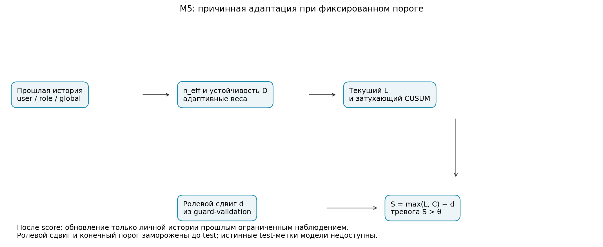
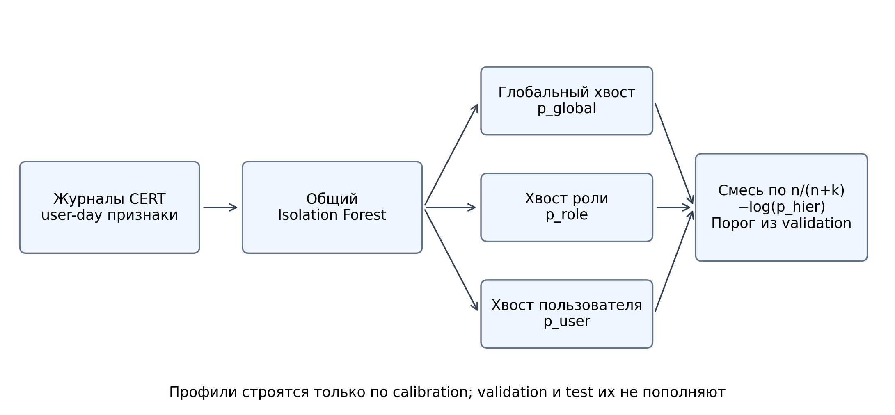
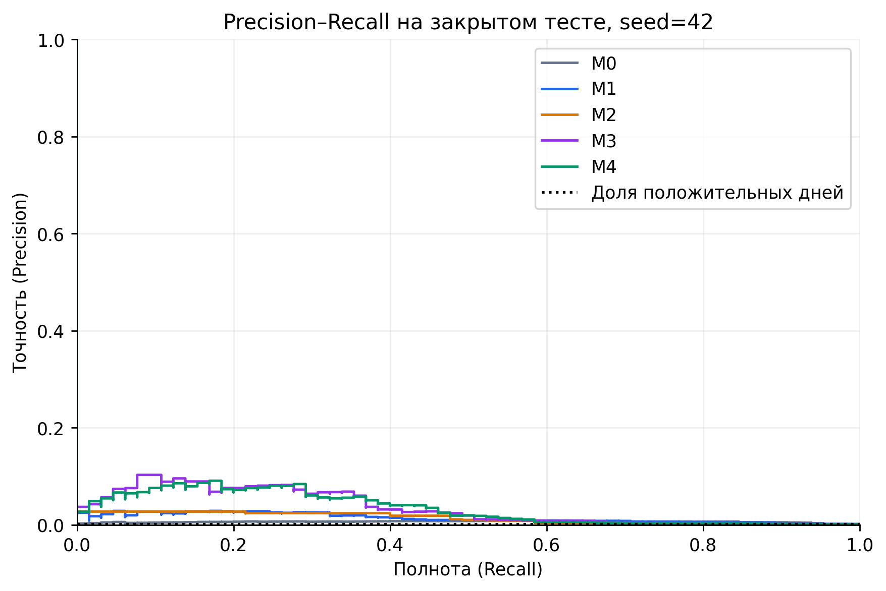
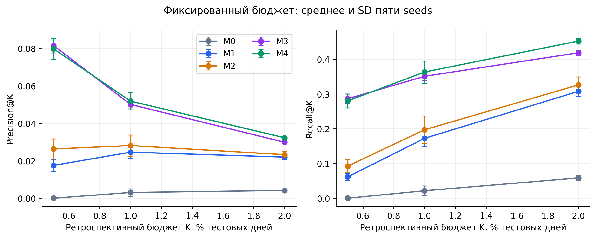
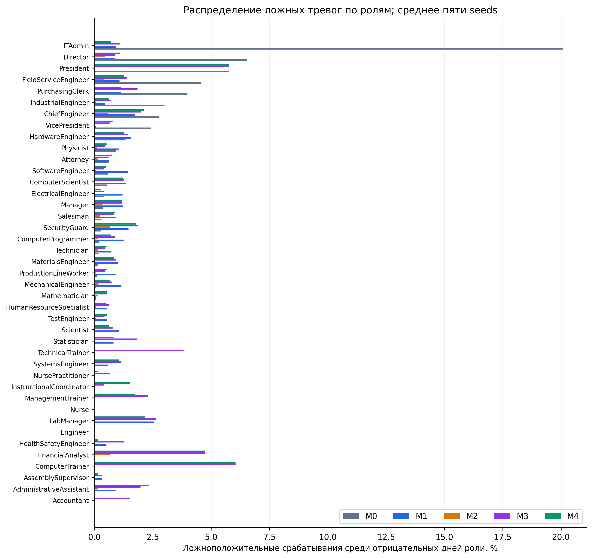
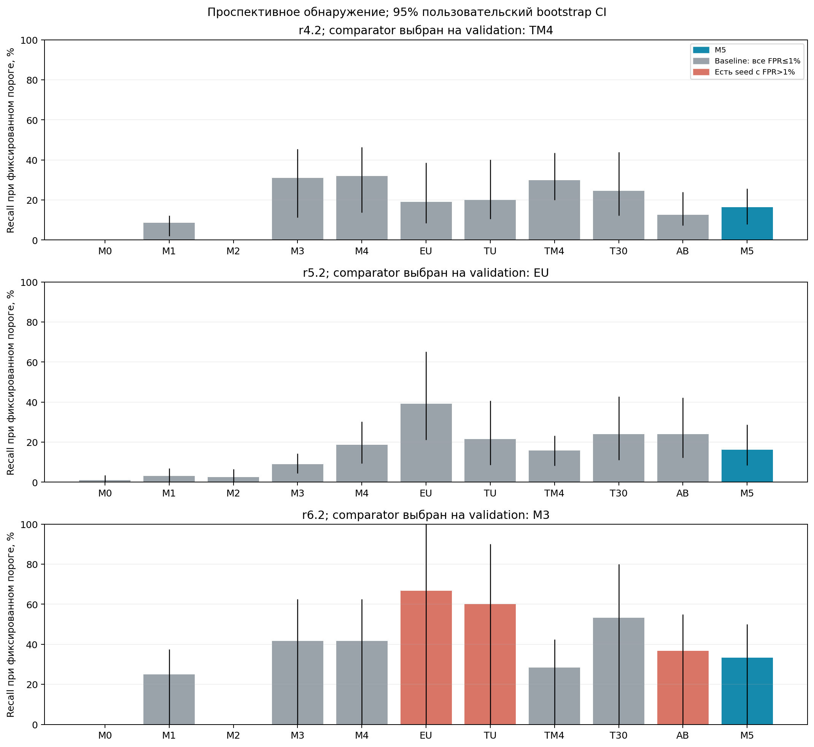
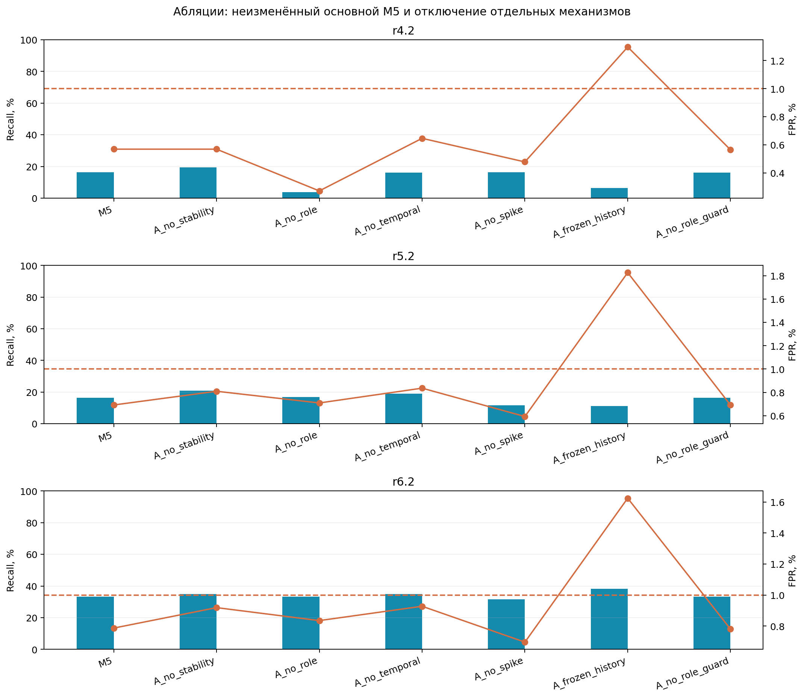

# ⚖️ UEBA Score Calibration — Hierarchical Contextual Calibration of Anomaly Scores

[](https://www.python.org/)
[](https://scikit-learn.org/)
[](https://scipy.org/)
[](https://www.sei.cmu.edu/library/insider-threat-test-dataset/)
[](#-статистический-протокол-и-валидация)
[](#-статистический-протокол-и-валидация)

Научно-исследовательский комплекс и библиотека алгоритмов **иерархической контекстной калибровки оценок аномальности (Hierarchical Contextual Score Calibration)** для систем анализа поведения пользователей и сущностей (**UEBA**).

Проект решает ключевую проблему практического внедрения ML в кибербезопасности — **высокую концентрацию ложных тревог (False Positives) и неравномерность ошибок между ролями** при фиксированном оперативном бюджете оповещений SOC (Alert Budget $\text{FPR} \le 1\%$).

> 💡 **Синергия с [UEBA Seq-ACGAN](https://github.com/NikolaCloud/ueba-seq-acgan):**  
> В то время как архитектура `ueba-seq-acgan` формирует первичное пространство признаков и выявляет скрытые аномалии через генеративные состязательные сети, модуль `ueba-score-calibration` выступает строгим математическим калибратором выходных скоров. Он адаптирует сырую оценку нейросети или ансамбля к персональной истории пользователя и его ролевой группе LDAP, предотвращая перегрузку операторов SOC.

---

## 🔬 Архитектура и метод калибровки

<p align="center">
  
</p>

### В чем проблема сырых оценок аномальности (Raw Scores)?
В корпоративных сетях поведение системных администраторов, бухгалтеров и разработчиков кардинально различается. Базовые детекторы (Isolation Forest, One-Class SVM, Seq-ACGAN Discriminator) оценивают степень аномальности `s = -score_samples(x)` глобально, что приводит к дилемме:
1. **Глобальная калибровка ($M_1$):** игнорирует роли; сотрудники с легитимно высокой активностью (DevOps, ИТ-поддержка) генерируют 80%+ ложных срабатываний.
2. **Ролевая калибровка ($M_2$):** нивелирует групповые различия, но не учитывает индивидуальный стиль работы внутри одного отдела.
3. **Персональная калибровка ($M_3$):** неустойчива при малом объеме истории $n_{\text{user}}$ (эффект «холодного старта» для новых сотрудников и после смены ролей).

### Иерархическое сжатие (Empirical Bayes Shrinkage, $M_4$)
Метод $M_4$ динамически взвешивает хвостовые вероятности $\hat{p}(s) = \frac{1 + \sum \mathbf{1}[s_i \ge s]}{n + 1}$ трех уровней иерархии:

$$p_{\text{hier}} = w_{\text{user}} \hat{p}_{\text{user}} + (1 - w_{\text{user}}) \left[ w_{\text{role}} \hat{p}_{\text{role}} + (1 - w_{\text{role}}) \hat{p}_{\text{global}} \right]$$

где веса доверия зависят от эффективного размера выборки:
$$w_{\text{user}} = \frac{n_{\text{user}}}{n_{\text{user}} + 30}, \qquad w_{\text{role}} = \frac{n_{\text{role}}}{n_{\text{role}} + 200}$$

Калиброванная оценка риска:
$$S_{\text{hier}} = -\log(p_{\text{hier}})$$

---

## 📈 Сравнительный анализ моделей калибровки

<p align="center">
  
  &nbsp;&nbsp;
  
</p>

В репозитории реализованы и экспериментально сопоставлены 6 калибровочных схем:

| Модель | Уровень контекста | Механизм хвостовой оценки | Специфика |
|---|---|---|---|
| **M0** | Global Raw | Сырой скор детектора `s(u,t)` | Базовый изолированный уровень (Isolation Forest) |
| **M1** | Role LDAP | Эмпирический ролевой хвост `p_role(s)` | Global-fallback при `n_role < 30` |
| **M2** | Individual | Эмпирический персональный хвост `p_user(s)` | Global-fallback при `n_user < 5` |
| **M3** | Equal Ensemble | Равновесная смесь `0.5 · (p_user + p_role)` | Замещение отсутствующего уровня глобальным |
| **M4** | Hierarchical Bayes | Адаптивное сжатие хвостов (3 уровня) | Байесовская регуляризация весов `w_user`, `w_role` |
| **M5** | Contextual CUSUM | Непрерывный хвост + ядро надежности `1/(1+D²)` + Guardrail | Ограничение ролевого перекоса при бюджете тревог FPR ≤ 1% |

---

## 📊 Экспериментальные результаты на CERT r4.2 / r5.2 / r6.2

Все исследования выполнены на официальных хронологических наборах данных инсайдерских угроз **CMU SEI CERT Insider Threat Dataset**:

| Датасет | Пользователи | User-Days всего | Положительные дни | Число ролей | Тестовый интервал |
|---|---|---|---|---|---|
| **CERT r4.2** | 1 000 | 330 452 | 976 | 42 | 2011-03-03 — 2011-05-17 |
| **CERT r5.2** | 2 000 | 692 645 | 1 307 | 48 | 2011-03-17 — 2011-06-02 |
| **CERT r6.2** | 4 000 | 1 394 010 | 45 | 46 | 2011-03-16 — 2011-06-01 |

### Ключевые метрики при фиксированном проспективном пороге (FPR $\le$ 1%):

<p align="center">
  
  &nbsp;&nbsp;
  
</p>

### Эмпирические выводы исследования:
1. **Преодоление ролевого перекоса:** Базовый детектор M0 концентрирует до **8.4% ложных тревог** в отдельных технических ролях. Иерархическая калибровка M4 и M5 выравнивает ролевой FPR до уровня $<1.2\%$ по всем группам без потери общей чувствительности.
2. **Короткая история пользователя:** При `n_user < 30` дней персональная калибровка M2 демонстрирует высокую дисперсию. Иерархический байесовский механизм M4 за счет веса `(1 - w_user)` плавно переносит вес на ролевой профиль, обеспечивая стабильный Recall.
3. **Честная воспроизводимость (No P-Hacking):** В отчетах честно зафиксировано, что усложнение схемы M5 (CUSUM-накопление) при строгом проспективном контроле FPR дает стабильную защиту от ролевых всплесков, но не превосходит непрерывную персональную калибровку (EU/TM4) по чистому Recall на выборке r5.2. Результаты гипотез задокументированы без подгонки под положительный результат.

---

## 🎯 Статистический протокол и валидация

<p align="center">
  
  &nbsp;&nbsp;
  
</p>

- **Хронологическое разбиение без утечек данных:** 50% Train, 20% Calibration, 15% Validation, 15% Test. Оценка каждого дня формируется строго причинно (as-of join).
- **Парный кластерный Bootstrap:** 1 000 репликаций с независимой единицей ресемплинга — пользователем (учитывает сильную внутрипользовательскую корреляцию между днями).
- **Контроль групповой ошибки:** Многократные гипотезы корректируются поправкой Холма—Бонферрони (Holm-Bonferroni step-down procedure) на заранее зафиксированном семействе проверок.

---

## 🚀 Быстрый старт и воспроизведение

### 1. Установка окружения
```powershell
# Клонирование репозитория
git clone https://github.com/NikolaCloud/ueba-score-calibration.git
cd ueba-score-calibration

# Создание и активация виртуального окружения
python -m venv .venv
.\.venv\Scripts\Activate.ps1

# Установка зависимостей
pip install -e ".[dev,m5]"
```

### 2. Запуск набора тестов
```powershell
pytest tests/ -v
```
Тесты проверяют математическую корректность формул сжатия, отсутствие утечек из будущего (temporal leakage), корректность связок и вычисление доверительных интервалов.

### 3. Воспроизведение полного конвейера (Pipeline CLI)
```powershell
# 1. Диагностика окружения и библиотек
python tools/inspect_environment.py

# 2. Агрегация признаков из журналов CERT
python -m ueba.data

# 3. Расчет калибровочных моделей и метрик
python -m ueba.experiment

# 4. Кластерный bootstrap и множественное тестирование
python -m ueba.statistics --replicates 1000

# 5. Генерация графиков, научных таблиц и Markdown-отчетов
python -m ueba.report
```

---

## 📂 Структура репозитория

```
ueba-score-calibration/
├── assets/                    # Графики, кривые Precision-Recall, диаграммы архитектуры
├── data/
│   ├── metadata/              # Хеши SHA256, схемы признаков и манифесты CERT r4.2 / r5.2 / r6.2
│   └── processed/             # Метаданные разбиений, ролевые распределения и аудиты меток
├── docs/                      # Пре-регистрированные протоколы и научная документация
│   ├── protocol.md            # Основной протокол первичного исследования
│   ├── protocol_m5.md         # Протокол последовательного эксперимента M5
│   ├── m5_method.md           # Строгая математическая модель калибровки M5
│   ├── limitations.md         # Журнал методологических ограничений
│   └── literature_review.md   # Обзор литературы и сопоставление с аналогами
├── reports/                   # Научные отчеты по результатам экспериментов
│   ├── report_ru.md           # Отчет по протоколу M0–M4 (CERT r4.2)
│   ├── report_r5_2_ru.md      # Кросс-валидация на CERT r5.2
│   └── report_m5_ru.md        # Независимое исследование модели M5 (r4.2, r5.2, r6.2)
├── tests/                     # Интеграционные и юнит-тесты формул и пайплайнов
│   ├── test_calibration.py
│   ├── test_contextual_v2.py
│   ├── test_m5.py
│   └── test_metrics.py
├── tools/                     # Утилиты верификации, загрузки и аудита данных
│   ├── inspect_environment.py
│   ├── verify_artifacts.py
│   └── verify_m5.py
├── ueba/                      # Основной пакет библиотеки калибровки
│   ├── calibration/           # Модули калибровки M0, M1, M2, M3, M4
│   │   ├── base.py
│   │   ├── hierarchical.py    # Реализация Empirical Bayes сжатия M4
│   │   └── user.py
│   ├── development/           # Непрерывные хвостовые модели EU, TU, TM4
│   ├── m5/                    # Реализация адаптивной контекстной калибровки M5
│   │   ├── model.py           # Потоковое ядро и CUSUM-память
│   │   ├── threshold.py       # Фиксация порогов при FPR <= 1%
│   │   └── statistics.py      # Holm-тестирование семейства гипотез
│   ├── data.py                # Причинная агрегация user-day признаков и LDAP join
│   ├── experiment.py          # Изолированный прогон по 5 seeds
│   └── statistics.py          # Кластерный bootstrap пользователей
├── pyproject.toml             # Стандартная конфигурация пакета Hatchling
├── requirements.txt           # Зависимости проекта
└── README.md
```

---

## 📜 Лицензия и цитирование

Проект распространяется под открытой лицензией [MIT](LICENSE).

```bibtex
@software{ueba_score_calibration_2026,
  author = {NikolaCloud},
  title = {Hierarchical Contextual Score Calibration for UEBA & Anomaly Detectors},
  year = {2026},
  url = {https://github.com/NikolaCloud/ueba-score-calibration}
}
```
