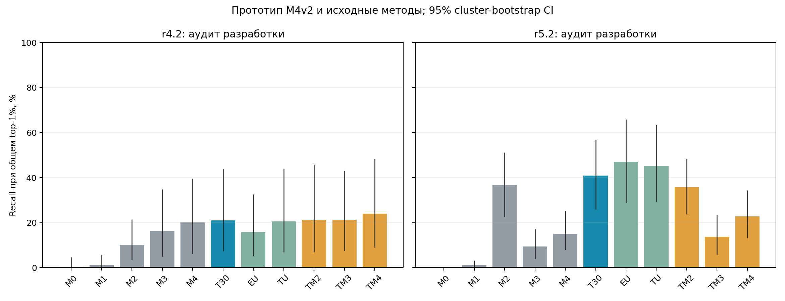
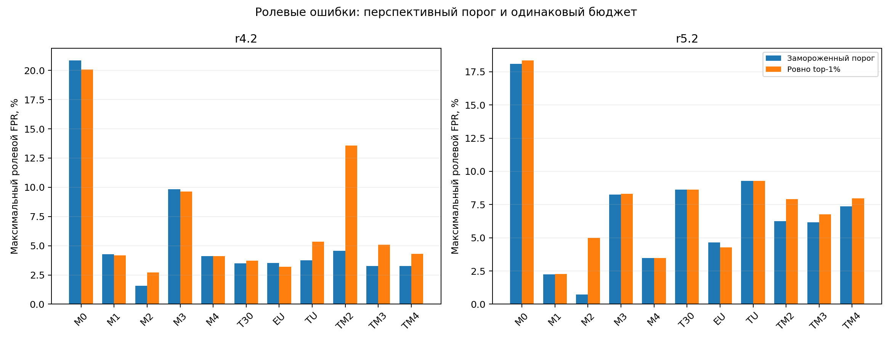
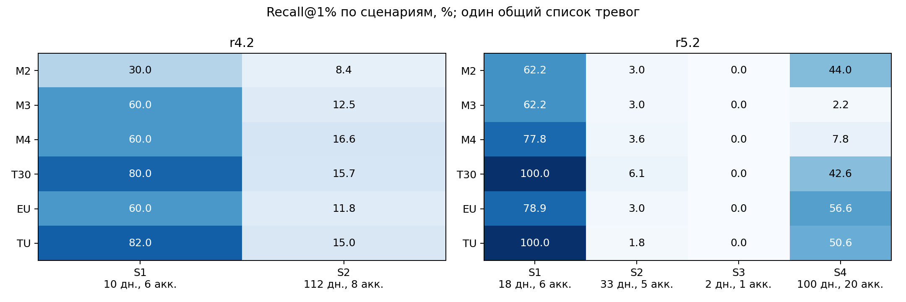

# Исследовательская разработка M4v2 на CERT r4.2/r5.2

Дата: 2026-11-02. Статус: **рабочий прототип с частичным успехом; превосходство над всеми методами не установлено**.

## Главный результат

Разработан отдельный вариант **M4v2 (T30)**: непрерывная экстраполяция персональных хвостов,
геометрическое иерархическое объединение и причинное накопление сигнала за 7 календарных дней.
Исходные M0–M4, параметры M4 (30/200), данные и прежние результаты сохранены.

На второй половине validation r5.2 Recall@1% вырос до **40.92%**
против 9.41% у M3 и 15.03% у M4.
Парные различия с M3 и M4 значимы в условном исследовательском анализе после Holm.
На r4.2 результат 20.98% против
20.16% у M4: разница мала и незначима.

Существенные ограничения: на r5.2 максимальный ролевой FPR вырос с
3.47% у M4 до 8.62% у прототипа.
Персональные абляции EU/TU имеют более высокий Recall на r5.2; преимущества иерархии над ними нет.
Таким образом, задача «заметно лучше M3 и всех остальных методов» целиком не решена.

## Границы исследования и выбор варианта

Пользователь ограничил работу прототипом и исследовательской оценкой на r4.2/r5.2.
r6.2 не загружался. Оба используемых выпуска ранее изучались; даже выделенная половина
validation не является независимо закрытым набором (часть дат пересекалась с прежними дополнительными
протоколами). Значимость здесь не превращает разработку в независимое подтверждение.

Использованы только calibration/validation основных протоколов. Прежний test не используется для
выбора новой формулы и повторной оценки её качества. Профили обучаются только на calibration.
Первая половина validation служит выбору модели и порогов, вторая — аудиту разработки.
Второй раунд использует тот же selection повторно; это раскрытая адаптивная разработка.
Метки используются для выбора на selection и расчёта метрик, но не для обучения профилей или
IsolationForest. Используются те же 17 признаков, те же детекторы и seeds 42–46.

| release | block | start | stop | days | positives | positive_accounts |
| --- | --- | --- | --- | --- | --- | --- |
| r4.2 | selection | 2010-12-18 | 2011-01-23 | 20209 | 80 | 10 |
| r4.2 | development_audit | 2011-01-24 | 2011-03-02 | 24929 | 122 | 14 |
| r5.2 | selection | 2010-12-29 | 2011-02-05 | 50525 | 139 | 28 |
| r5.2 | development_audit | 2011-02-06 | 2011-03-16 | 51733 | 153 | 32 |

В первом раунде ни один из пяти кандидатов не выполнил одновременно на двух выпусках
критерий Recall@1% ≥ лучшего M0–M4 и max-role FPR ≤ 1.1*M3. По протоколу оценён
заранее назначенный EB30; его не переименовывали в успешный вариант.

| Вариант | r4.2 Recall, % | r4.2 max FPR, % | r5.2 Recall, % | r5.2 max FPR, % |
| --- | --- | --- | --- | --- |
| G30 | 13.50 | 5.31 | 14.68 | 4.07 |
| Z30 | 5.75 | 4.62 | 19.71 | 13.53 |
| EB30 | 6.75 | 4.46 | 14.10 | 8.85 |
| EB90 | 7.00 | 4.15 | 15.25 | 30.30 |
| UZ | 6.75 | 4.46 | 14.10 | 3.62 |

Второй, последний раунд был зафиксирован до расчёта его новых scores. При проектировании были
изучены selection-результаты первого раунда; его файл аудита уже существовал, но значения не
использовались. Критерий отбора оставлен тем же. Прошёл и выбран **T30**.
Выбор записан в selection_round2.json до расчёта метрик второго аудита.
После аудита новый победитель не выбирался, следующих поисковых раундов не проводилось.

| Вариант | r4.2 Recall, % | r4.2 max FPR, % | r5.2 Recall, % | r5.2 max FPR, % |
| --- | --- | --- | --- | --- |
| E30 | 14.50 | 4.52 | 19.14 | 3.70 |
| E5 | 13.75 | 5.31 | 20.43 | 3.70 |
| EU | 13.75 | 4.66 | 20.58 | 3.70 |
| T30 | 20.75 | 5.45 | 19.42 | 3.75 |
| T5 | 17.00 | 6.06 | 20.58 | 5.09 |
| TU | 16.25 | 6.06 | 19.86 | 5.09 |
| TG30 | 19.00 | 6.06 | 12.95 | 3.51 |

## Формула прототипа

Для каждого замороженного user/role/global-профиля строится эмпирический верхний хвост.
В наблюдаемых точках сохранено `(1 + #reference ≥ s)/(n+1)`, между точками — линейная
интерполяция. Выше максимума m применяется `log p(s)=log p(m)-(s-m)/b`.
Это устраняет одинаковую минимальную вероятность у разных экстремальных отклонений.
Это рабочая модель хвоста, **не** conformal p-value и не гарантия FPR.

b — среднее превышение над 75-м перцентилем; пользовательский масштаб сглажен к типичному
внутрипользовательскому масштабу роли с весом n/(n+30), ролевой — к глобальному с n/(n+200).
Есть нижняя граница масштаба для постоянных профилей. История привязана к (user,role).

`E30 = -[wu*log(pu) + (1-wu)*(wr*log(pr) + (1-wr)*log(pg))]`,
где `wu=nu/(nu+30)`, `wr=nr/(nr+200)`; отсутствующий профиль имеет вес 0.

`T30(u,t) = mean(E30(u,d): t-7 суток < d ≤ t)`.

Среднее включает текущий день и только прошлые доступные дни данного пользователя.
Нерабочие дни не добавляются. История начинается с начала validation; selection обеспечивает
прогрев к аудиту. Ни будущие scores, ни будущие метки не используются.
Накопление может ухудшать одиночные атаки и задерживать сигнал; задержка первого обнаружения
в этом исследовании отдельно не оценена. Метод не объявляется математически новым.

G30 — геометрическое объединение без экстраполяции; Z/EB — робастная непрерывная нормировка
с фиксированным/эмпирическим shrinkage; UZ — её персональная абляция.
EU — персональная экстраполяция без иерархии (при отсутствии user — role/global);
TU — накопление EU. E5/T5 ослабляют смешивание с ролью, k_user=5.

## Аудит: общий бюджет и проспективные ошибки

Все числа — средние по пяти seeds. Recall@1% использует ровно ceil(0.01*N) верхних
user-days и детерминированное разрешение связок по SHA256(user|date).
Пороговая тревога — score строго выше 99-го перцентиля selection; порог затем заморожен.
Эти две постановки различаются. У дискретного M2 порог даёт сильно меньше 1% тревог,
а у T30 на r4.2 доля тревог снижается при переносе во времени. Поэтому приведены также
ролевые ошибки при одинаковом ретроспективном top-1% бюджете.
max FPR — максимум по всем ролям; n≥100 исключает роли с менее 100 отрицательных дней
в исходном аудите. Метрика каждого seed сначала рассчитывается отдельно, затем усредняется.

| Выпуск | Метод | Recall@1%, % | Recall при пороге, % | Тревоги, % | max FPR, % | max FPR n≥100, % | max FPR top-1%, % |
| --- | --- | --- | --- | --- | --- | --- | --- |
| r4.2 | M0 | 0.33 | 0.82 | 1.079 | 20.85 | 20.85 | 20.08 |
| r4.2 | M1 | 1.15 | 1.48 | 1.037 | 4.29 | 4.29 | 4.17 |
| r4.2 | M2 | 10.16 | 0.00 | 0.153 | 1.59 | 1.21 | 2.73 |
| r4.2 | M3 | 16.39 | 19.34 | 1.172 | 9.82 | 6.07 | 9.64 |
| r4.2 | M4 | 20.16 | 20.49 | 1.108 | 4.13 | 3.51 | 4.13 |
| r4.2 | T30 | 20.98 | 19.18 | 0.684 | 3.48 | 3.48 | 3.71 |
| r4.2 | EU | 15.74 | 16.72 | 1.203 | 3.51 | 3.17 | 3.21 |
| r4.2 | TU | 20.49 | 19.02 | 0.696 | 3.74 | 3.74 | 5.35 |
| r4.2 | TM2 | 21.15 | 14.75 | 0.339 | 4.57 | 1.39 | 13.57 |
| r4.2 | TM3 | 21.15 | 17.21 | 0.513 | 3.27 | 3.27 | 5.07 |
| r4.2 | TM4 | 23.93 | 18.52 | 0.455 | 3.27 | 3.27 | 4.30 |
| r5.2 | M0 | 0.00 | 0.00 | 0.968 | 18.10 | 17.25 | 18.35 |
| r5.2 | M1 | 1.18 | 1.18 | 0.929 | 2.25 | 2.25 | 2.26 |
| r5.2 | M2 | 36.73 | 0.65 | 0.167 | 0.72 | 0.72 | 5.00 |
| r5.2 | M3 | 9.41 | 8.89 | 0.955 | 8.26 | 4.06 | 8.32 |
| r5.2 | M4 | 15.03 | 14.77 | 0.996 | 3.47 | 2.73 | 3.47 |
| r5.2 | T30 | 40.92 | 40.78 | 0.989 | 8.62 | 7.41 | 8.62 |
| r5.2 | EU | 46.93 | 47.06 | 1.092 | 4.64 | 2.03 | 4.29 |
| r5.2 | TU | 45.23 | 45.23 | 0.998 | 9.29 | 7.41 | 9.29 |
| r5.2 | TM2 | 35.69 | 32.29 | 0.809 | 6.26 | 5.06 | 7.90 |
| r5.2 | TM3 | 13.73 | 12.16 | 0.864 | 6.18 | 4.94 | 6.76 |
| r5.2 | TM4 | 22.75 | 20.52 | 0.837 | 7.36 | 4.24 | 7.97 |

## Статистическая неопределённость

9999 парных bootstrap-выборок пользователей. Все дни выбранного пользователя переносятся
вместе; одни и те же multiplicities используются для сравниваемых методов и пяти seeds.
Внутри каждой выборки результаты seeds усредняются. Top-1% пересчитывается для размера
bootstrap-когорты; пороги не переоцениваются. Оценка условна на уже обученных детекторах,
профилях, выбранном варианте и фиксированных порогах; неопределённость всего процесса выбора
и переносимости на новый выпуск она не включает.

Одна семья Holm: 28 сравнений T30 с M0–M4, EU/TU, два показателя (Recall@1%, max-role FPR),
два выпуска. Приведены 95% percentile CI и двусторонний центрированный bootstrap p-value.
Эти CI и тест не дуальны: исключение нуля из CI само по себе не означает значимость по этому p.

| Выпуск | Разность | Δ Recall, п.п. | 95% CI, п.п. | p Holm |
| --- | --- | --- | --- | --- |
| r4.2 | T30-M2 | 10.82 | [1.40; 25.28] | 1.0000 |
| r4.2 | T30-M3 | 4.59 | [-2.48; 13.89] | 1.0000 |
| r4.2 | T30-M4 | 0.82 | [-7.48; 11.11] | 1.0000 |
| r4.2 | T30-EU | 5.25 | [-0.39; 14.49] | 1.0000 |
| r4.2 | T30-TU | 0.49 | [-2.15; 2.99] | 1.0000 |
| r5.2 | T30-M2 | 4.18 | [-3.03; 12.87] | 1.0000 |
| r5.2 | T30-M3 | 31.50 | [17.23; 46.25] | 0.0052 |
| r5.2 | T30-M4 | 25.88 | [11.87; 40.11] | 0.0100 |
| r5.2 | T30-EU | -6.01 | [-13.69; 0.95] | 1.0000 |
| r5.2 | T30-TU | -4.31 | [-9.92; -0.61] | 1.0000 |

Полные результаты, включая max-role FPR: [paired_comparisons.csv](../results/m4_v2_development/paired_comparisons.csv).
На r5.2 Recall выше M3/M4, но значимого выигрыша над M2 и персональными абляциями нет.
На r4.2 выигрыша над M3/M4 по Recall статистически не установлено.

## Проверка вклада временного усреднения

Дополнительная диагностика добавлена после просмотра основного аудита и так и обозначается.
TM2/TM3/TM4 — исходные scores соответствующих методов с тем же 7-дневным средним.
Пороги по-прежнему заданы на selection. Эта проверка не меняет выбор T30 и не служит
новым поисковым раундом. Её 12 сравнений образуют отдельную семью Holm.

| Выпуск | Метод | Recall@1%, % | max FPR, % |
| --- | --- | --- | --- |
| r4.2 | T30 | 20.98 | 3.48 |
| r4.2 | TM2 | 21.15 | 4.57 |
| r4.2 | TM3 | 21.15 | 3.27 |
| r4.2 | TM4 | 23.93 | 3.27 |
| r5.2 | T30 | 40.92 | 8.62 |
| r5.2 | TM2 | 35.69 | 6.26 |
| r5.2 | TM3 | 13.73 | 6.18 |
| r5.2 | TM4 | 22.75 | 7.36 |

См. [сравнения контролей](../results/m4_v2_development/temporal_control_comparisons.csv).
На r4.2 простое накопление исходного M4 (TM4) имеет больший Recall, чем T30.
На r5.2 T30 превосходит TM3 в этой дополнительной семье, но его отличие от TM4
после Holm незначимо. Следовательно, превосходство новой калибровки над исходной
при одинаковом накоплении не подтверждено на обоих выпусках.
Пользу экстраполяции и иерархии нельзя выводить только из сравнения накопительного T30 с
исходным однодневным M4: часть улучшения может давать само накопление.

## Разные сценарии внутренних угроз

Официальные метки и сопоставимые исходные признаки взяты из уже проверенных подготовок r4.2/r5.2.
Дневные показатели не измеряют число предотвращённых инцидентов. Для каждого сценария
используется один и тот же общий top-1% список, отдельного бюджета на сценарий нет.
Сценарий с менее 20 положительных дней или 5 аккаунтов имеет слабую поддержку.
Отсутствие положительных дней не трактуется как нулевой Recall: такие сценарии в таблице опущены.

| Выпуск | Сценарий | Дни | Аккаунты | M2 | M3 | M4 | T30 | EU | TU |
| --- | --- | --- | --- | --- | --- | --- | --- | --- | --- |
| r4.2 | 1 | 10 | 6 | 30.00 | 60.00 | 60.00 | 80.00 | 60.00 | 82.00 |
| r4.2 | 2 | 112 | 8 | 8.39 | 12.50 | 16.61 | 15.71 | 11.79 | 15.00 |
| r5.2 | 1 | 18 | 6 | 62.22 | 62.22 | 77.78 | 100.00 | 78.89 | 100.00 |
| r5.2 | 2 | 33 | 5 | 3.03 | 3.03 | 3.64 | 6.06 | 3.03 | 1.82 |
| r5.2 | 3 | 2 | 1 | 0.00 | 0.00 | 0.00 | 0.00 | 0.00 | 0.00 |
| r5.2 | 4 | 100 | 20 | 44.00 | 2.20 | 7.80 | 42.60 | 56.60 | 50.60 |

Для S4 на r5.2 есть заметный выигрыш над исходными M3/M4, однако EU/TU лучше T30.
Для S2 r4.2 накопление не превосходит исходный M4; на r5.2 S2 общий Recall остаётся низким.
По S3 в этом аудите всего 2 дня у одного аккаунта: вывода о переносимости сделать нельзя.
Таким образом, устойчивое преимущество иерархического прототипа на всех сценариях не установлено.

## Артефакты и воспроизведение

- [Протокол первого раунда](../docs/protocol_m4_v2.md), [второго](../docs/protocol_m4_v2_round2.md),
  [дополнительных контролей](../docs/m4_v2_temporal_controls.md).
- [Решение второго раунда](../results/m4_v2_development/selection_round2.json),
  [сводная таблица](../results/m4_v2_development/audit_summary.csv),
  [доверительные интервалы](../results/m4_v2_development/confidence_intervals.csv).
- [Проверки артефактов](artifact_validation_m4_v2.json), [команды](../README_M4_V2.md).
- Формулы исходных M0–M4 сверены с прежним пакетом; scores baseline совпадают с прежними
  validation_predictions. Новые реализации находятся отдельно в ueba/development/.

Прототип обоснован как направление разработки, особенно для r5.2; оснований заменять им
исходный M4 как доказанно лучший метод пока нет. Для подтверждения нужен новый закрытый
набор после фиксации формулы, с контролем ролевых ошибок и проверкой против EU/TU и TM2–TM4.
Такая проверка выходит за выбранный пользователем объём текущей работы.
