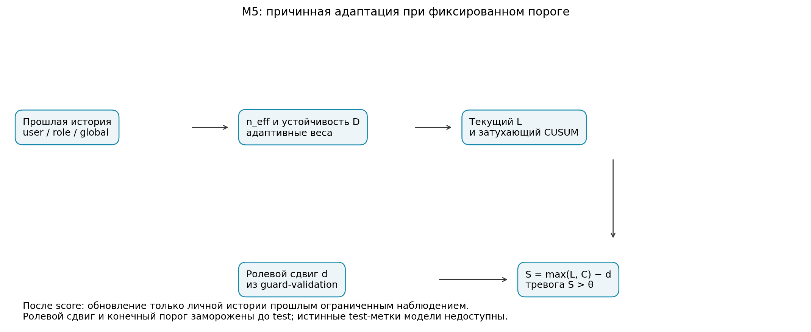
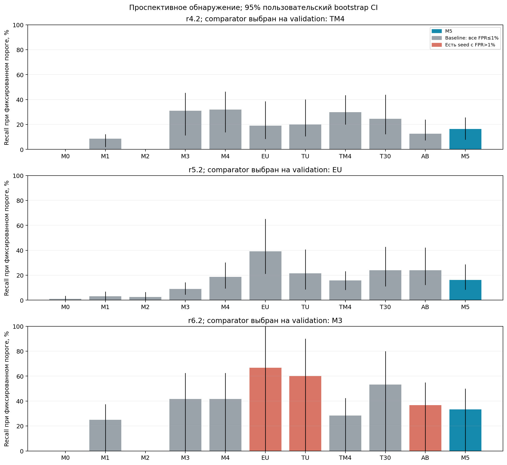
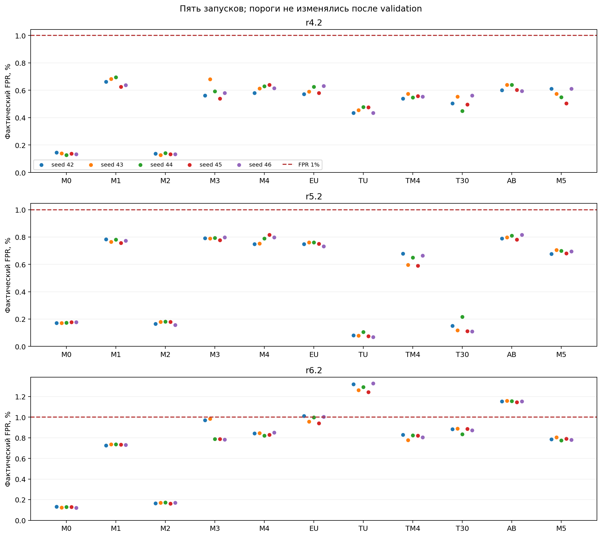
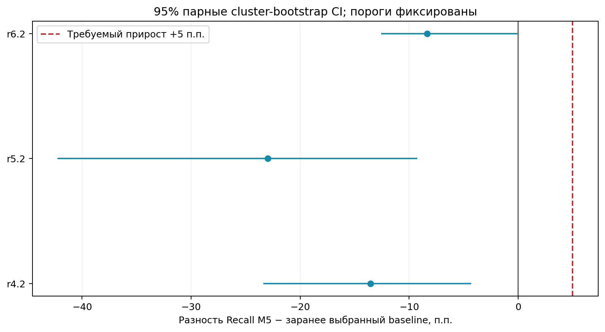
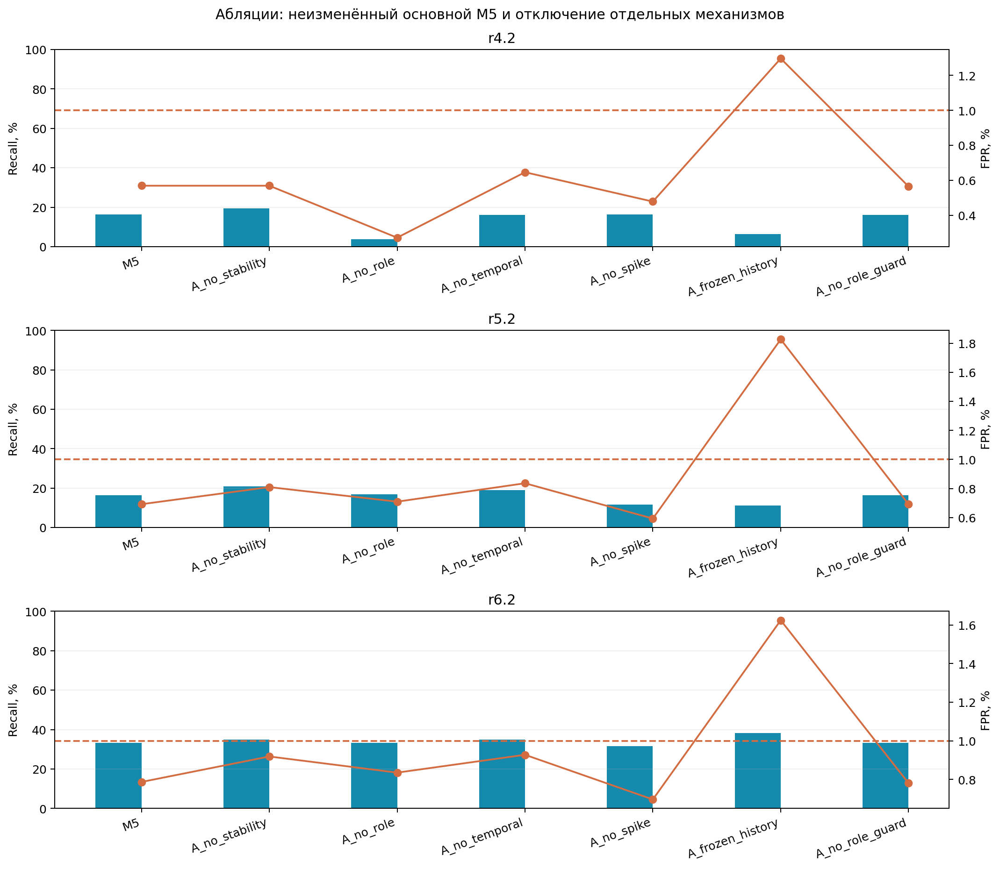
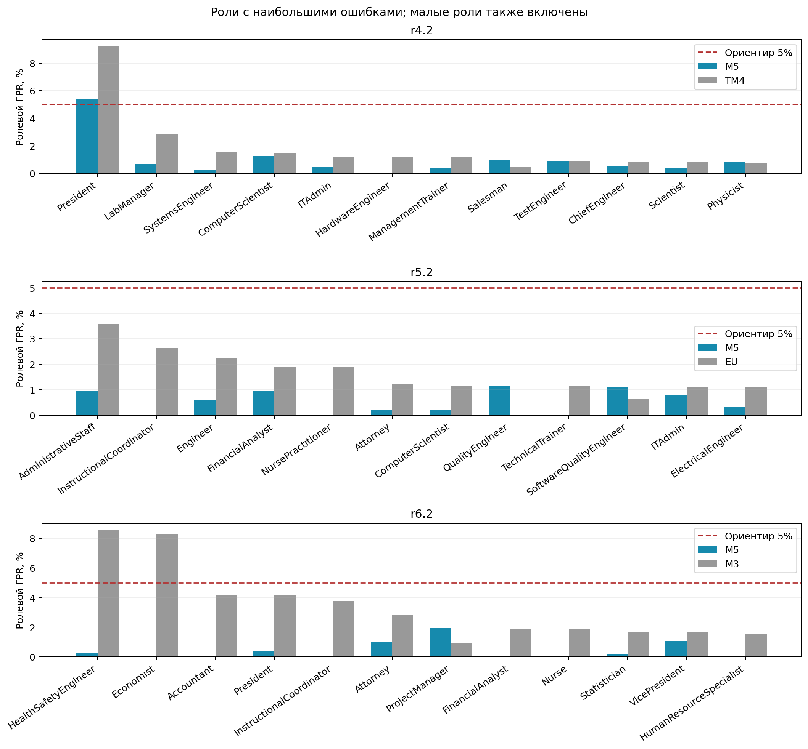
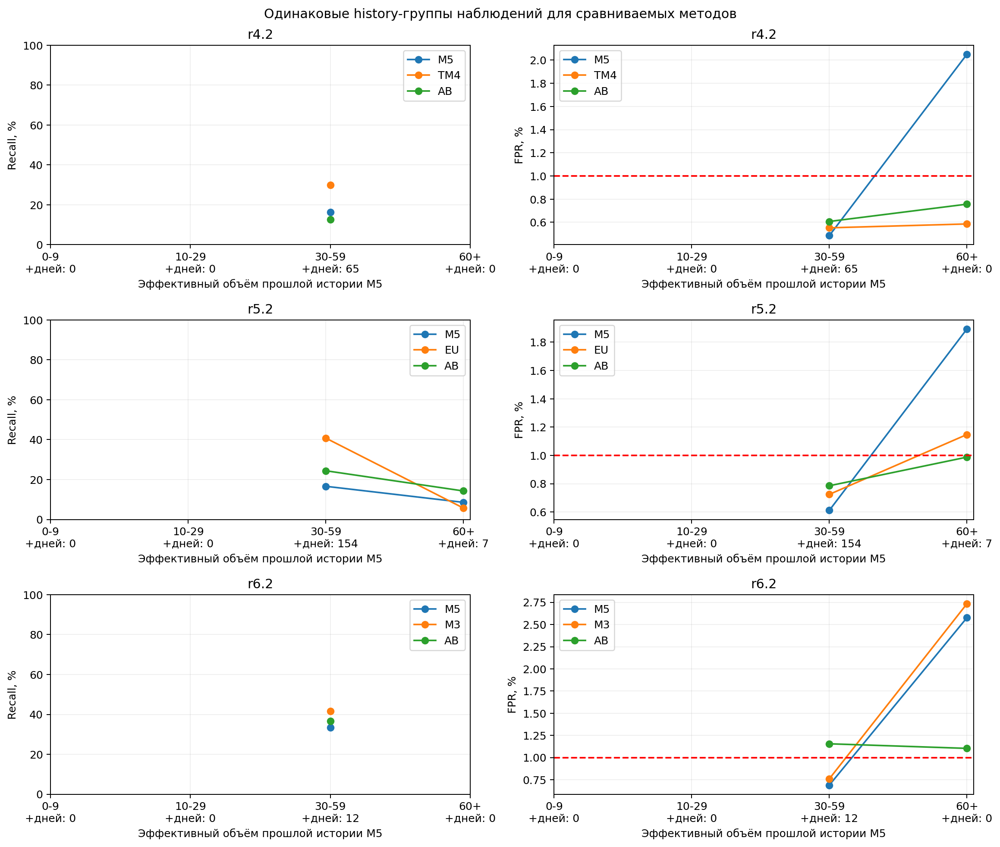
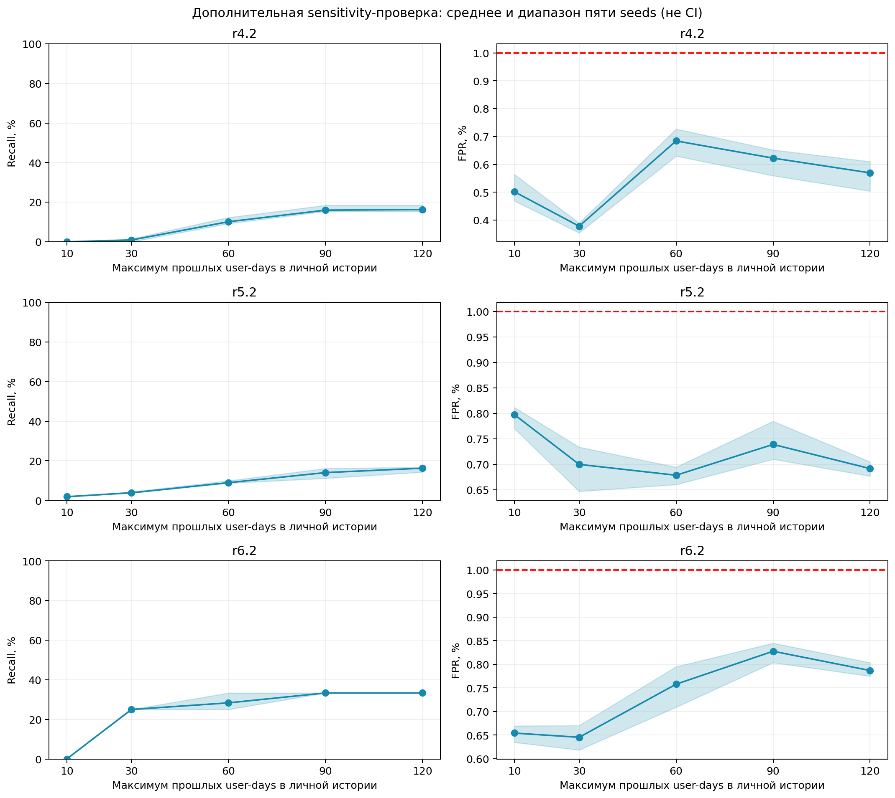
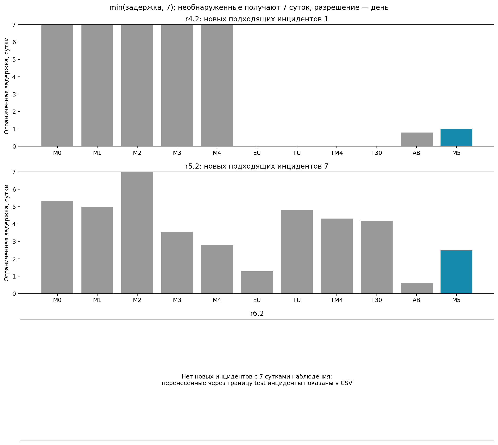

# M5: адаптивная контекстная калибровка при фиксированном пороге

Дата: 2026-11-02. Итоговое решение: **C — гипотеза повышения эффективности не подтверждена**.

## Ответ на главный исследовательский вопрос

Разработан и выполнен M5: адаптивные веса по объёму/устойчивости личной истории,
непрерывные user/role/global хвосты, причинный CUSUM с отдельным одиночным путём и
ролевой защитный сдвиг. Проверялся один заранее заданный основной вариант, без
переименования лучшей абляции в M5 после test. Порог фиксировался на validation.

Конструкция опирается на [предшествующую разработку EU/TU/TM4/T30](report_m4_v2_ru.md):
непрерывный личный хвост и накопление давали выигрыш отдельных метрик, однако
иерархия не превосходила персональные абляции, а Recall мог сопровождаться ростом
ролевых ошибок. Поэтому M5 проверяет именно надёжность личного контекста,
одиночный путь и групповой guard; преимущества этих дополнений не предполагаются заранее.

- **r4.2:** M5 Recall 16.31%, FPR 0.570%; TM4 Recall 29.85%. Разность -13.54 п.п.; 95% CI [-23.33; -4.37].
- **r5.2:** M5 Recall 16.27%, FPR 0.692%; EU Recall 39.25%. Разность -22.98 п.п.; 95% CI [-42.20; -9.32].
- **r6.2:** M5 Recall 33.33%, FPR 0.787%; M3 Recall 41.67%. Разность -8.33 п.п.; 95% CI [-12.50; 0.00].

Независимая проверка r6.2 выполнена после фиксации кода и правил. Её test не использовался для изменения алгоритма, параметров, comparator или порога.

Общий вывод определяется приростом Recall **при соблюдённом фактическом FPR**, а не
улучшением отдельных групповых ошибок или top-1% ранжирования. При невыполненном
критерии +5 п.п. оснований объявлять M5 лучшим методом нет. Дополнительная защита
от ролевой концентрации оценивается отдельно от основной полноты обнаружения.

## 1. Данные и протокол

| Выпуск | Пользователи | Все user-days | Положительные дни | Роли | Test user-days | Test +дни | Test +аккаунты | Test даты |
| --- | --- | --- | --- | --- | --- | --- | --- | --- |
| r4.2 | 1000 | 330452 | 976 | 42 | 45460 | 65 | 9 | 2011-03-03 — 2011-05-17 |
| r5.2 | 2000 | 692645 | 1307 | 48 | 96766 | 161 | 25 | 2011-03-17 — 2011-06-02 |
| r6.2 | 4000 | 1394010 | 45 | 46 | 198243 | 12 | 2 | 2011-03-16 — 2011-06-01 |

Все выпуски используют 17 сопоставимых признаков user-day: счётчики logon/logoff,
USB, операций с файлами на съёмном носителе, исходящих писем, внешних получателей,
событий вне 08:00–18:00, выходных дней, уникальных PC и общей интенсивности.
Данные HTTP **не входят в признаки**, но официальные HTTP observables сохраняются
при построении дневных меток. Для r5.2/r6.2 email учитывает только Send, file —
Write/Copy с to_removable_media=True; у r4.2 file — съёмные копирования. Различие
детализации Write/Copy остаётся ограничением сопоставимости и не скрывается.
LDAP присоединён backward-as-of по дате, без использования будущей роли.

Метки — отмеченные официальными ключами account-days, включая проверенную подмену
учётных записей и подготовительные observables. Это не все дни сотрудника и не все
дни между началом/концом инцидента. Прежние метки r4.2/r5.2 сохранены.

В r6.2 всего 5 официальных инцидентов. Все 470
исходных ссылок сохранены; включено 423, исключено 47
не-инсайдерских контекстных событий, подтверждено 3 действия
под похищенной учётной записью. В ключе S3 есть обычная переписка коллег после массового письма;
она не объявлялась атакой. Master-start S4 содержит опечатку, используются точные timestamps
наблюдаемых событий. Правило зафиксировано до расчёта scores в
[плане аудита разметки](../docs/m5_r6_label_audit_plan.md). Само присутствие owner-события в ключе
включает подготовительную активность и не доказывает злонамеренность каждой строки.

Внешнее разбиение: 50/20/15/15% глобального календарного диапазона на
train/calibration/validation/test. Внутри validation первая половина служит ролевому
guard, вторая — порогу и выбору comparator. Доли, даты, исходные метки и признаки не
изменялись для увеличения числа атак. Поддержка всех подготовленных частей:

| block | start | stop_exclusive | days | users | positives | positive_users | release |
| --- | --- | --- | --- | --- | --- | --- | --- |
| train | 2010-01-02 | 2010-09-09 | 173946 | 1000 | 375 | 29 | r4.2 |
| calibration | 2010-09-09 | 2010-12-18 | 65908 | 942 | 334 | 37 | r4.2 |
| validation | 2010-12-18 | 2011-03-03 | 45138 | 895 | 202 | 19 | r4.2 |
| test | 2011-03-03 | 2011-05-18 | 45460 | 868 | 65 | 9 | r4.2 |
| train | 2010-01-02 | 2010-09-17 | 361094 | 2000 | 460 | 34 | r5.2 |
| calibration | 2010-09-17 | 2010-12-29 | 132527 | 1901 | 394 | 38 | r5.2 |
| validation | 2010-12-29 | 2011-03-17 | 102258 | 1839 | 292 | 42 | r5.2 |
| test | 2011-03-17 | 2011-06-03 | 96766 | 1799 | 161 | 25 | r5.2 |
| train | 2010-01-02 | 2010-09-17 | 722278 | 4000 | 6 | 3 | r6.2 |
| calibration | 2010-09-17 | 2010-12-29 | 268487 | 3839 | 1 | 1 | r6.2 |
| validation | 2010-12-29 | 2011-03-16 | 205002 | 3744 | 26 | 2 | r6.2 |
| test | 2011-03-16 | 2011-06-02 | 198243 | 3684 | 12 | 2 | r6.2 |

В train/calibration присутствуют официально отмеченные атаки. Они не удалялись
по будущим/целевым меткам при обучении общего unsupervised detector и профилей:
сохранён прежний протокол. Начальные нормы поэтому не считаются гарантированно
чистыми. Истинные метки использованы для аудита и validation-выбора порога, а не
для очистки профилей. Внутренние границы M5:

| release | block | start | end | days | positives | positive_accounts |
| --- | --- | --- | --- | --- | --- | --- |
| r4.2 | calibration | 2010-09-09 | 2010-12-17 | 65908 | 334 | 37 |
| r4.2 | guard | 2010-12-18 | 2011-01-23 | 20209 | 80 | 10 |
| r4.2 | threshold | 2011-01-24 | 2011-03-02 | 24929 | 122 | 14 |
| r5.2 | calibration | 2010-09-17 | 2010-12-28 | 132527 | 394 | 38 |
| r5.2 | guard | 2010-12-29 | 2011-02-05 | 50525 | 139 | 28 |
| r5.2 | threshold | 2011-02-06 | 2011-03-16 | 51733 | 153 | 32 |
| r6.2 | calibration | 2010-09-17 | 2010-12-28 | 268487 | 1 | 1 |
| r6.2 | guard | 2010-12-29 | 2011-02-04 | 102866 | 3 | 1 |
| r6.2 | threshold | 2011-02-05 | 2011-03-15 | 102136 | 23 | 2 |

r4.2/r5.2 ранее использовались в разработке и остаются **исследовательскими** наборами,
даже когда M5 обрабатывает их test впервые. На r6.2 до фиксации кода проверены только
источники, схемы и разметка; тестовые scores/метрики не использовались при проектировании.
При малом числе атак внешний выпуск проверяет перенос в узком смысле и не обеспечивает
высокую мощность для утверждений обо всех сценариях.

## 2. Детектор, сравнение и порог

Один общий IsolationForest на каждый seed: 200 деревьев, max_samples=min(2048,n_train),
seeds 42–46. Median imputation и StandardScaler обучены только на train. Оценка —
минус score_samples, больше означает аномальнее. r4.2/r5.2 используют прежние detector
scores без переобучения; на r6.2 обучение повторено с теми же параметрами.

Сравниваются M0–M4, EU, TU, TM4, T30, простой адаптивный AB, основной M5 и шесть
абляций. Исходные M0–M4 и M4(30/200) не изменены. EU — персональный непрерывный
хвост; TU — его 7-дневное среднее; TM4 — 7-дневное среднее M4; T30 — 7-дневное
среднее геометрической иерархии с непрерывными хвостами. Эти методы продолжают свои
причинные окна через границу test; frozen-методы сохраняют calibration-профили.

AB — скользящий личный хвост со старением истории, score=max(текущее evidence,
среднее за 7 суток), без надёжностного смешивания и CUSUM. Поэтому он проверяет,
нужна ли сложная адаптация сверх простой персональной онлайн-калибровки.

Для всех методов theta выбирается на одних и тех же threshold-validation датах:
отрицательные квантили для FPR .25/.5/.75/1%; кандидаты повышаются до эмпирического
предела max-role FPR≤5% на ролях с ≥100 отрицательных дней. Берётся минимальный
кандидат, у которого верхняя односторонняя 95%-я bootstrap-оценка FPR≤1% (999
выборок пользователей). Нет допустимого кандидата — theta=+infinity, без тревог.
Решение: score **строго больше** theta. По test theta не перенастраивается.
Bootstrap-отбор порога — осторожная эвристика, а не finite-sample гарантия после отбора.

Новые численные пороговые результаты отличаются от прежних отчётов M0–M4:
теперь используется отрицательный validation-класс, отдельная половина validation,
кластерная оценка FPR и общий ролевой предел. Это изменение **общего протокола порога**,
а не изменение формул baseline. Сравнивать старую таблицу с новой как разные модели нельзя.

Comparator каждого выпуска выбирается до test по наибольшему среднему validation-Recall
среди десяти baseline; при равенстве — меньший FPR, затем фиксированный порядок.
Выбор: r4.2 → TM4, r5.2 → EU, r6.2 → M3. Лучший метод по уже открывшемуся
test не подставляется вместо зафиксированного comparator. Таблица всех методов позволяет
видеть и такие случаи, когда иной baseline оказывается лучше на test.

## 3. Математическая модель и причинность

Полное описание формул, параметров и псевдокода: [m5_method.md](../docs/m5_method.md).
Ниже — основные зависимости:

`w_i=2^(-age_days/60)`, `n_eff=min(sum(w),sum(w)^2/sum(w²))`;
`D=|median(last10)-median(previous≤40)|/max(1.4826*MAD,role_tail_scale,floor)`;
`wu=n_eff/(n_eff+30)/(1+D²)`, `wr=n_role/(n_role+200)`;

`L=-wu*log(p_user)-(1-wu)*(wr*log(p_role)+(1-wr)*log(p_global))`;
`C=max(0,exp(-delta_days/7)*C_previous+min(L,8)-2)`;
`Z=max(L,C)`, `S=Z-d_role`, `alert=(S>theta)`.

Личная история ограничена 120 наблюдениями текущей роли. Все параметры хвоста,
D и веса вычисляются **до добавления текущего score**. Новый score ограничивается
прошлыми Q05−3*b/Q95+3*b и добавляется после решения; метки не участвуют.
Role/global остаются замороженными. При смене роли личное состояние и накопление
сбрасываются. Ролевой сдвиг d=max(0,Q95_role−Q95_global) оценивается на guard только
по отрицательным дням и затем замораживается, малые/новые роли используют d=0.

Непрерывный хвост — интерполяция weighted ECDF плюс экспоненциальное продолжение
выше максимума. Его **нельзя называть валидным conformal p-value** без дополнительной
теоремы. CUSUM не является доказанным e-process. Числа 60/120/30/200/7/8/2 заданы
в протоколе, а не найдены поиском по test. Они могут быть неудачны — именно это
должен выявить эксперимент.

Единица потока — пользовательский день. Решение доступно после завершения дня,
не в момент отдельной записи журнала. Обработка по (user,date) эквивалентна календарному
потоку, поскольку изменяемого межпользовательского состояния нет. Проверены
совпадение последовательных batches с единым проходом, независимость префикса от
изменения будущих scores, независимость от test-меток и сброс при смене роли.

## 4. Сравнительные результаты

Средние по пяти seeds; худший FPR показывает отдельное нарушение, которое могло бы
скрыться в среднем. Recall при FPR>1% не объявляется допустимым основным результатом.
Пороговые показатели и ретроспективный Recall@1% — разные задачи. В частности,
дискретный M2 может хорошо ранжировать, но почти не выдавать тревог при строгом пороге
из-за связок. Тестовый порог для исправления этой проблемы задним числом не меняется.

| Выпуск | Метод | Recall, % | FPR, % | FPR худший seed, % | Precision, % | Recall@1%, % | max-role FPR, % | max-role n≥100, % | FPR≤1% все seeds |
| --- | --- | --- | --- | --- | --- | --- | --- | --- | --- |
| r4.2 | M0 | 0.00 | 0.137 | 0.145 | 0.00 | 2.15 | 4.75 | 4.75 | да |
| r4.2 | M1 | 8.62 | 0.660 | 0.694 | 1.83 | 17.23 | 1.92 | 1.92 | да |
| r4.2 | M2 | 0.00 | 0.135 | 0.141 | 0.00 | 19.69 | 1.13 | 0.74 | да |
| r4.2 | M3 | 31.08 | 0.591 | 0.681 | 7.01 | 35.08 | 6.84 | 6.05 | да |
| r4.2 | M4 | 32.00 | 0.615 | 0.639 | 6.93 | 36.31 | 5.98 | 4.87 | да |
| r4.2 | EU | 19.08 | 0.600 | 0.632 | 4.36 | 23.38 | 3.85 | 1.92 | да |
| r4.2 | TU | 20.00 | 0.456 | 0.478 | 5.92 | 30.46 | 1.16 | 1.16 | да |
| r4.2 | TM4 | 29.85 | 0.554 | 0.575 | 7.16 | 35.69 | 9.23 | 2.82 | да |
| r4.2 | T30 | 24.62 | 0.513 | 0.562 | 6.45 | 30.77 | 2.63 | 1.78 | да |
| r4.2 | AB | 12.62 | 0.615 | 0.639 | 2.85 | 16.31 | 5.38 | 1.28 | да |
| r4.2 | M5 | 16.31 | 0.570 | 0.610 | 3.95 | 24.00 | 5.38 | 1.28 | да |
| r5.2 | M0 | 1.12 | 0.174 | 0.178 | 1.06 | 2.73 | 4.55 | 4.55 | да |
| r5.2 | M1 | 3.11 | 0.772 | 0.784 | 0.67 | 3.11 | 1.72 | 1.72 | да |
| r5.2 | M2 | 2.61 | 0.172 | 0.181 | 2.46 | 33.04 | 1.40 | 0.68 | да |
| r5.2 | M3 | 9.07 | 0.790 | 0.797 | 1.88 | 12.80 | 7.55 | 3.40 | да |
| r5.2 | M4 | 18.76 | 0.781 | 0.816 | 3.85 | 21.74 | 4.15 | 3.96 | да |
| r5.2 | EU | 39.25 | 0.751 | 0.762 | 8.01 | 40.75 | 3.77 | 3.58 | да |
| r5.2 | TU | 21.49 | 0.082 | 0.105 | 30.70 | 35.78 | 3.68 | 3.68 | да |
| r5.2 | TM4 | 15.78 | 0.636 | 0.678 | 3.98 | 19.88 | 10.75 | 10.75 | да |
| r5.2 | T30 | 23.98 | 0.141 | 0.217 | 22.91 | 34.41 | 3.68 | 3.68 | да |
| r5.2 | AB | 23.98 | 0.799 | 0.816 | 4.76 | 26.21 | 3.21 | 3.21 | да |
| r5.2 | M5 | 16.27 | 0.692 | 0.705 | 3.78 | 19.75 | 1.57 | 1.15 | да |
| r6.2 | M0 | 0.00 | 0.128 | 0.133 | 0.00 | 16.67 | 4.81 | 4.81 | да |
| r6.2 | M1 | 25.00 | 0.732 | 0.736 | 0.21 | 25.00 | 1.27 | 1.27 | да |
| r6.2 | M2 | 0.00 | 0.168 | 0.174 | 0.00 | 58.33 | 2.64 | 1.34 | да |
| r6.2 | M3 | 41.67 | 0.862 | 0.983 | 0.29 | 41.67 | 9.23 | 4.15 | да |
| r6.2 | M4 | 41.67 | 0.838 | 0.851 | 0.30 | 43.33 | 7.13 | 3.19 | да |
| r6.2 | EU | 66.67 | 0.982 | 1.011 | 0.41 | 66.67 | 4.03 | 2.02 | **НЕТ** |
| r6.2 | TU | 60.00 | 1.288 | 1.326 | 0.28 | 58.33 | 4.90 | 3.55 | **НЕТ** |
| r6.2 | TM4 | 28.33 | 0.811 | 0.830 | 0.21 | 38.33 | 4.58 | 3.27 | да |
| r6.2 | T30 | 53.33 | 0.873 | 0.888 | 0.37 | 55.00 | 3.82 | 2.67 | да |
| r6.2 | AB | 36.67 | 1.152 | 1.158 | 0.19 | 33.33 | 2.26 | 1.85 | **НЕТ** |
| r6.2 | M5 | 33.33 | 0.787 | 0.804 | 0.26 | 33.33 | 2.03 | 1.96 | да |

## 5. Основной критерий и статистическое сравнение

Критерий зафиксирован заранее: все пять фактических FPR M5≤1%, верхняя 95% граница
FPR≤1%, прирост Recall≥5 п.п., нижняя 95% граница прироста>5 п.п. и значимость Holm.
Он не заменяется критерием улучшения только max-role FPR или Recall@1%.

| Выпуск | M5 FPR, % | 95% CI FPR, % | FPR≤1% все seeds | Верх CI≤1% | Прирост ≥5 п.п. и нижний CI>5 | Полный критерий |
| --- | --- | --- | --- | --- | --- | --- |
| r4.2 | 0.570 | [0.412; 0.764] | да | да | нет | нет |
| r5.2 | 0.692 | [0.556; 0.841] | да | да | нет | нет |
| r6.2 | 0.787 | [0.683; 0.902] | да | да | нет | нет |

9999 парных кластерных выборок пользователей; все дни пользователя переносятся
вместе, multiplicities одинаковы между методами и seeds. Внутри выборки усредняются
пять seeds. Обучение, validation-пороги, ролевые сдвиги и comparator заново не выбираются.
При top-1% бюджет пересчитывается по размеру bootstrap-когорты. Это условная
неопределённость test-когорты, а не всего процесса выбора/обучения и не переноса в
другую организацию. Пять seeds не считаются пятью независимыми популяциями сотрудников.

Семья основных сравнений — M5 против заранее выбранного comparator, Recall/FPR,
все завершённые выпуски: 6 тестов. Отдельная исследовательская
семья всех сравнений M5 с baseline/абляциями по Recall/FPR/max-role FPR:
144 тестов. Указаны percentile CI и двусторонний центрированный
bootstrap p-value. Они не дуальны: CI, исключающий ноль, не обязан соответствовать
значимому p. Неполные семьи до завершения r6.2 не являются окончательными.

| Выпуск | Сравнение | Показатель | Разность, п.п. | 95% CI, п.п. | p центрированный | p Holm | Bootstrap с определённой метрикой |
| --- | --- | --- | --- | --- | --- | --- | --- |
| r4.2 | M5-TM4 | recall | -13.538 | [-23.333; -4.372] | 0.01690 | 0.08452 | 9997 |
| r4.2 | M5-TM4 | fpr | 0.015 | [-0.150; 0.203] | 0.85850 | 0.85850 | 9999 |
| r5.2 | M5-EU | recall | -22.981 | [-42.199; -9.320] | 0.01180 | 0.07080 | 9999 |
| r5.2 | M5-EU | fpr | -0.060 | [-0.202; 0.096] | 0.42140 | 0.84280 | 9999 |
| r6.2 | M5-M3 | recall | -8.333 | [-12.500; 0.000] | 0.26378 | 0.79134 | 8635 |
| r6.2 | M5-M3 | fpr | -0.075 | [-0.167; 0.025] | 0.12570 | 0.50280 | 9999 |

| Выпуск | Пользователей в test | +аккаунты | Выборок без +дней |
| --- | --- | --- | --- |
| r4.2 | 868 | 9 | 2 |
| r5.2 | 1799 | 25 | 0 |
| r6.2 | 3684 | 2 | 1364 |

Выборки без положительных дней имеют неопределённый Recall и исключаются только из
его интервала; число таких выборок раскрыто. При одном-двух положительных аккаунтах
bootstrap не создаёт новых типов атак: даже узкий условный интервал не доказывает
перенос на популяцию сценариев. Для общего независимого утверждения здесь отдельно
отмечается поддержка менее пяти положительных аккаунтов, а не выдаётся сильная гарантия.

## 6. Абляции и причины неудач

| Выпуск | Метод | Recall, % | FPR, % | FPR худший seed, % | Precision, % | Recall@1%, % | max-role FPR, % | max-role n≥100, % | FPR≤1% все seeds |
| --- | --- | --- | --- | --- | --- | --- | --- | --- | --- |
| r4.2 | M5 | 16.31 | 0.570 | 0.610 | 3.95 | 24.00 | 5.38 | 1.28 | да |
| r4.2 | A_no_stability | 19.38 | 0.570 | 0.590 | 4.66 | 25.23 | 5.77 | 1.29 | да |
| r4.2 | A_no_role | 3.69 | 0.273 | 0.344 | 1.84 | 14.77 | 4.64 | 3.26 | да |
| r4.2 | A_no_temporal | 16.00 | 0.647 | 0.663 | 3.43 | 22.15 | 5.77 | 1.86 | да |
| r4.2 | A_no_spike | 16.31 | 0.479 | 0.555 | 4.64 | 22.77 | 2.46 | 1.30 | да |
| r4.2 | A_frozen_history | 6.46 | 1.297 | 1.403 | 0.71 | 3.69 | 3.73 | 3.73 | **НЕТ** |
| r4.2 | A_no_role_guard | 16.00 | 0.565 | 0.610 | 3.91 | 24.31 | 5.38 | 1.21 | да |
| r5.2 | M5 | 16.27 | 0.692 | 0.705 | 3.78 | 19.75 | 1.57 | 1.15 | да |
| r5.2 | A_no_stability | 20.99 | 0.809 | 0.865 | 4.15 | 22.36 | 2.64 | 2.16 | да |
| r5.2 | A_no_role | 16.77 | 0.709 | 0.757 | 3.80 | 19.50 | 17.58 | 3.71 | да |
| r5.2 | A_no_temporal | 19.01 | 0.836 | 0.853 | 3.65 | 20.25 | 2.83 | 2.27 | да |
| r5.2 | A_no_spike | 11.68 | 0.593 | 0.621 | 3.18 | 17.64 | 1.53 | 1.53 | да |
| r5.2 | A_frozen_history | 11.18 | 1.827 | 1.837 | 1.01 | 5.22 | 7.82 | 3.24 | **НЕТ** |
| r5.2 | A_no_role_guard | 16.40 | 0.691 | 0.703 | 3.81 | 19.01 | 1.61 | 1.23 | да |
| r6.2 | M5 | 33.33 | 0.787 | 0.804 | 0.26 | 33.33 | 2.03 | 1.96 | да |
| r6.2 | A_no_stability | 35.00 | 0.919 | 0.937 | 0.23 | 35.00 | 2.61 | 2.59 | да |
| r6.2 | A_no_role | 33.33 | 0.835 | 0.843 | 0.24 | 36.67 | 8.64 | 8.64 | да |
| r6.2 | A_no_temporal | 35.00 | 0.928 | 0.964 | 0.23 | 36.67 | 3.10 | 2.96 | да |
| r6.2 | A_no_spike | 31.67 | 0.696 | 0.724 | 0.28 | 33.33 | 2.38 | 2.38 | да |
| r6.2 | A_frozen_history | 38.33 | 1.624 | 1.635 | 0.14 | 26.67 | 3.71 | 3.71 | **НЕТ** |
| r6.2 | A_no_role_guard | 33.33 | 0.780 | 0.795 | 0.26 | 33.33 | 2.20 | 2.20 | да |

**Факты.** Отключение оценки устойчивости изменяет Recall относительно полного M5;
это прямо видно в таблице, но лучшая абляция не переименовывается в новый метод.
Замороженная личная история может нарушать тестовый FPR несмотря на допустимую
validation-калибровку. Простой AB и EU показывают, какую часть результата даёт сама
персонализация без сложного сочетания контекстов. Полные CI и скорректированные
сравнения абляций сохранены в paired_comparisons.csv; без них различие точек не
называется статистически подтверждённым механизмом.

В A_frozen_history старение весов и CUSUM продолжаются, замораживается только
добавление наблюдений: его нельзя отождествлять со статичным EU. В A_no_role
отключена ролевая терма объединения, но отдельный ролевой guard сохранён.

- r4.2: без штрафа устойчивости Recall меняется с 16.31% до 19.38%; AB даёт 12.62%, EU — 19.08%. У frozen-history FPR 1.297%; без role-guard Recall 16.00%.
- r5.2: без штрафа устойчивости Recall меняется с 16.27% до 20.99%; AB даёт 23.98%, EU — 39.25%. У frozen-history FPR 1.827%; без role-guard Recall 16.40%.
- r6.2: без штрафа устойчивости Recall меняется с 33.33% до 35.00%; AB даёт 36.67%, EU — 66.67%. У frozen-history FPR 1.624%; без role-guard Recall 33.33%.

Диагностика состояния показывает, на каких наблюдениях срабатывает предполагаемый
механизм. Это описательная связь, не дополнительный подтверждающий тест и не подбор
нового коэффициента. Положительные дни могут иметь меньший личный вес именно
из-за изменения поведения, которое требуется обнаруживать:

| Выпуск | Дни | Средний вес user | Средний D | C>L, % |
| --- | --- | --- | --- | --- |
| r4.2 | отрицательные | 0.584 | 0.236 | 1.29 |
| r4.2 | положительные | 0.475 | 0.595 | 13.85 |
| r5.2 | отрицательные | 0.582 | 0.257 | 1.28 |
| r5.2 | положительные | 0.534 | 0.487 | 9.07 |
| r6.2 | отрицательные | 0.576 | 0.272 | 1.44 |
| r6.2 | положительные | 0.559 | 0.325 | 0.00 |

В positive_day_disagreements.csv отдельно указаны дни, обнаруженные только baseline,
только M5, обоими или ни одним. Сравниваются собственные фиксированные пороги методов,
поэтому такое расхождение не изолирует причину независимо от перекалибровки threshold.

**Объяснения, согласующиеся с данными.** При начале устойчивого отклонения растёт D,
а вес пользовательского контекста уменьшается. Если действие необычно лично для
сотрудника, но нормально для роли, роль маскирует сигнал. Личное обновление также
может поглощать длительную атаку; winsorization ограничивает, но не исключает это.
Одновременно CUSUM и одиночный путь увеличивают разнообразие обычных хвостов,
поэтому конечный порог должен компенсировать их ложные срабатывания. Сохранение
пика в raw score не означает сохранение его Recall после такой перекалибровки.

**Гипотезы для будущей работы.** Нужны независимые проверки альтернативного критерия
устойчивости, отдельного детектора легитимного дрейфа и защищённого обновления.
Они не реализованы как следующий поисковый раунд после этого test. Отрицательный
результат данной спецификации нельзя подменять обещанием улучшения новой версии.

## 7. Профессиональные группы и длина истории

Ролевой guard и общий порог пытаются ограничить концентрацию ошибок. Это проверяется
по всем ролям и отдельно при ≥100 отрицательных дней. Предел 5% — validation-условие
для достаточно поддержанных ролей; на test он не гарантирован. Малые роли не
исключаются из полного максимума, и их нестабильность не скрывается усреднением.

Для всех методов используются одни и те же группы наблюдений по n_eff M5, без
перенастройки порогов внутри групп. Это условная связь качества с доступной историей,
а не рандомизированный эксперимент её обрезания. Группы с нулевой поддержкой имеют
неопределённый Recall. Числа относятся к user-days, не к независимым атакам.

| Выпуск | Метод | n_eff | Дни | +дни | Recall, % | FPR, % |
| --- | --- | --- | --- | --- | --- | --- |
| r4.2 | AB | 0-9 | 0 | 0 | — | — |
| r4.2 | AB | 10-29 | 0 | 0 | — | — |
| r4.2 | AB | 30-59 | 43002 | 65 | 12.62 | 0.607 |
| r4.2 | AB | 60+ | 2458 | 0 | — | 0.757 |
| r4.2 | M5 | 0-9 | 0 | 0 | — | — |
| r4.2 | M5 | 10-29 | 0 | 0 | — | — |
| r4.2 | M5 | 30-59 | 43002 | 65 | 16.31 | 0.485 |
| r4.2 | M5 | 60+ | 2458 | 0 | — | 2.050 |
| r4.2 | TM4 | 0-9 | 0 | 0 | — | — |
| r4.2 | TM4 | 10-29 | 0 | 0 | — | — |
| r4.2 | TM4 | 30-59 | 43002 | 65 | 29.85 | 0.552 |
| r4.2 | TM4 | 60+ | 2458 | 0 | — | 0.586 |
| r5.2 | AB | 0-9 | 0 | 0 | — | — |
| r5.2 | AB | 10-29 | 0 | 0 | — | — |
| r5.2 | AB | 30-59 | 90748 | 154 | 24.42 | 0.786 |
| r5.2 | AB | 60+ | 6018 | 7 | 14.29 | 0.988 |
| r5.2 | EU | 0-9 | 0 | 0 | — | — |
| r5.2 | EU | 10-29 | 0 | 0 | — | — |
| r5.2 | EU | 30-59 | 90748 | 154 | 40.78 | 0.725 |
| r5.2 | EU | 60+ | 6018 | 7 | 5.71 | 1.148 |
| r5.2 | M5 | 0-9 | 0 | 0 | — | — |
| r5.2 | M5 | 10-29 | 0 | 0 | — | — |
| r5.2 | M5 | 30-59 | 90748 | 154 | 16.62 | 0.612 |
| r5.2 | M5 | 60+ | 6018 | 7 | 8.57 | 1.893 |
| r6.2 | AB | 0-9 | 0 | 0 | — | — |
| r6.2 | AB | 10-29 | 0 | 0 | — | — |
| r6.2 | AB | 30-59 | 187966 | 12 | 36.67 | 1.155 |
| r6.2 | AB | 60+ | 10277 | 0 | — | 1.103 |
| r6.2 | M3 | 0-9 | 0 | 0 | — | — |
| r6.2 | M3 | 10-29 | 0 | 0 | — | — |
| r6.2 | M3 | 30-59 | 187966 | 12 | 41.67 | 0.760 |
| r6.2 | M3 | 60+ | 10277 | 0 | — | 2.734 |
| r6.2 | M5 | 0-9 | 0 | 0 | — | — |
| r6.2 | M5 | 10-29 | 0 | 0 | — | — |
| r6.2 | M5 | 30-59 | 187966 | 12 | 33.33 | 0.689 |
| r6.2 | M5 | 60+ | 10277 | 0 | — | 2.577 |

### Дополнительная проверка ёмкости

Естественные когорты почти не содержат короткой истории. После основного теста
r4.2/r5.2 и до test r6.2 отдельно объявлена sensitivity-сетка 10/30/60/90/120
наблюдений. Это диагностическая проверка, не новый поиск победителя: основной M5
остаётся с 120. Для каждой ёмкости threshold переоценивается только на validation.
Role/global используют прежний полный calibration. Вариант 120 обязан совпасть с
основным M5, что проверяется по scores и threshold каждого seed.
Заштрихованный диапазон — min/max пяти seeds, **не** 95% CI. Без новой статистической
семьи по этому рисунку не заявляется значимое улучшение. Протокол и статус добавления
раскрыты в [m5_history_sensitivity.md](../docs/m5_history_sensitivity.md).

| Выпуск | Ёмкость, user-days | Recall, % | FPR, % | FPR худший seed, % | Средний n_eff |
| --- | --- | --- | --- | --- | --- |
| r4.2 | 10 | 0.00 | 0.502 | 0.564 | 9.16 |
| r4.2 | 30 | 0.92 | 0.378 | 0.390 | 23.62 |
| r4.2 | 60 | 10.15 | 0.684 | 0.727 | 38.26 |
| r4.2 | 90 | 16.00 | 0.623 | 0.652 | 47.15 |
| r4.2 | 120 | 16.31 | 0.570 | 0.610 | 52.50 |
| r5.2 | 10 | 1.86 | 0.797 | 0.812 | 9.16 |
| r5.2 | 30 | 3.85 | 0.700 | 0.734 | 23.60 |
| r5.2 | 60 | 8.94 | 0.679 | 0.695 | 38.24 |
| r5.2 | 90 | 14.04 | 0.739 | 0.785 | 47.22 |
| r5.2 | 120 | 16.27 | 0.692 | 0.705 | 52.63 |
| r6.2 | 10 | 0.00 | 0.654 | 0.669 | 9.16 |
| r6.2 | 30 | 25.00 | 0.645 | 0.670 | 23.59 |
| r6.2 | 60 | 28.33 | 0.758 | 0.795 | 38.21 |
| r6.2 | 90 | 33.33 | 0.828 | 0.845 | 47.17 |
| r6.2 | 120 | 33.33 | 0.787 | 0.804 | 52.55 |

## 8. Сценарии и задержка

Пороговые Recall по официальным сценариям (%). Отсутствующие положительные сценарии
не объявляются нулевыми: они опущены. Поддержка <20 дней или <5 аккаунтов мала.
Остальные положительные сценарии не переобозначаются отрицательными.

| Выпуск | Сценарий | +дни | +аккаунты | M5 | AB | M3 | M4 | EU | TU | TM4 | T30 |
| --- | --- | --- | --- | --- | --- | --- | --- | --- | --- | --- | --- |
| r4.2 | 1 | 1 | 1 | 0.00 | 0.00 | 0.00 | 0.00 | 0.00 | 0.00 | 0.00 | 0.00 |
| r4.2 | 2 | 61 | 6 | 15.74 | 11.48 | 33.11 | 34.10 | 18.69 | 18.03 | 29.84 | 23.28 |
| r4.2 | 3 | 3 | 2 | 33.33 | 40.00 | 0.00 | 0.00 | 33.33 | 66.67 | 40.00 | 60.00 |
| r5.2 | 1 | 8 | 3 | 82.50 | 87.50 | 45.00 | 55.00 | 85.00 | 62.50 | 70.00 | 80.00 |
| r5.2 | 2 | 65 | 3 | 4.92 | 1.85 | 7.69 | 8.00 | 5.23 | 0.00 | 17.85 | 3.08 |
| r5.2 | 3 | 6 | 3 | 10.00 | 46.67 | 16.67 | 23.33 | 33.33 | 0.00 | 0.00 | 0.00 |
| r5.2 | 4 | 82 | 16 | 19.27 | 33.66 | 6.10 | 23.41 | 62.20 | 36.10 | 10.00 | 36.83 |
| r6.2 | 2 | 4 | 1 | 0.00 | 0.00 | 0.00 | 0.00 | 0.00 | 0.00 | 0.00 | 0.00 |
| r6.2 | 4 | 8 | 1 | 50.00 | 55.00 | 62.50 | 62.50 | 100.00 | 90.00 | 42.50 | 80.00 |

Задержка считается от первого официально отмеченного дня инцидента до первой
пороговой тревоги на его отмеченном дне в test. Начавшиеся до test отмечены как
left-censored: раннее обнаружение до теста неизвестно, и их задержка не называется
полной задержкой метода. Для новых инцидентов с ≥7 сутками наблюдения приводится
mean min(delay,7), необнаруженные получают 7. Отдельная доля обнаруженных сохраняет
необнаруженные случаи в знаменателе. Медиана новых обнаруженных не заменяет этот
показатель и может быть неопределённой. Разрешение — сутки; первый observable может
быть подготовкой, поэтому это не точное время от начала злонамеренного действия.

| Выпуск | Метод | Инциденты в test | Начаты до test | Новые с 7 сутками | Обнаружено в test, % | Медиана задержки новых обнаруженных, сут. | Ограниченная задержка, сут. |
| --- | --- | --- | --- | --- | --- | --- | --- |
| r4.2 | AB | 8 | 7 | 1 | 67.50 | 0.80 | 0.80 |
| r4.2 | EU | 8 | 7 | 1 | 67.50 | 0.00 | 0.00 |
| r4.2 | M0 | 8 | 7 | 1 | 0.00 | — | 7.00 |
| r4.2 | M1 | 8 | 7 | 1 | 42.50 | — | 7.00 |
| r4.2 | M2 | 8 | 7 | 1 | 0.00 | — | 7.00 |
| r4.2 | M3 | 8 | 7 | 1 | 50.00 | — | 7.00 |
| r4.2 | M4 | 8 | 7 | 1 | 55.00 | — | 7.00 |
| r4.2 | M5 | 8 | 7 | 1 | 62.50 | 1.00 | 1.00 |
| r4.2 | T30 | 8 | 7 | 1 | 65.00 | 0.00 | 0.00 |
| r4.2 | TM4 | 8 | 7 | 1 | 75.00 | 0.00 | 0.00 |
| r4.2 | TU | 8 | 7 | 1 | 75.00 | 0.00 | 0.00 |
| r5.2 | AB | 25 | 18 | 7 | 67.20 | 0.00 | 0.60 |
| r5.2 | EU | 25 | 18 | 7 | 65.60 | 0.00 | 1.29 |
| r5.2 | M0 | 25 | 18 | 7 | 7.20 | 0.40 | 5.31 |
| r5.2 | M1 | 25 | 18 | 7 | 12.00 | 0.00 | 5.00 |
| r5.2 | M2 | 25 | 18 | 7 | 5.60 | — | 7.00 |
| r5.2 | M3 | 25 | 18 | 7 | 38.40 | 0.10 | 3.54 |
| r5.2 | M4 | 25 | 18 | 7 | 52.00 | 0.20 | 2.80 |
| r5.2 | M5 | 25 | 18 | 7 | 52.80 | 0.00 | 2.49 |
| r5.2 | T30 | 25 | 18 | 7 | 47.20 | 0.70 | 4.20 |
| r5.2 | TM4 | 25 | 18 | 7 | 40.00 | 1.10 | 4.31 |
| r5.2 | TU | 25 | 18 | 7 | 41.60 | 1.40 | 4.80 |
| r6.2 | AB | 2 | 2 | 0 | 50.00 | — | — |
| r6.2 | EU | 2 | 2 | 0 | 50.00 | — | — |
| r6.2 | M0 | 2 | 2 | 0 | 0.00 | — | — |
| r6.2 | M1 | 2 | 2 | 0 | 50.00 | — | — |
| r6.2 | M2 | 2 | 2 | 0 | 0.00 | — | — |
| r6.2 | M3 | 2 | 2 | 0 | 50.00 | — | — |
| r6.2 | M4 | 2 | 2 | 0 | 50.00 | — | — |
| r6.2 | M5 | 2 | 2 | 0 | 50.00 | — | — |
| r6.2 | T30 | 2 | 2 | 0 | 50.00 | — | — |
| r6.2 | TM4 | 2 | 2 | 0 | 50.00 | — | — |
| r6.2 | TU | 2 | 2 | 0 | 50.00 | — | — |

При малом количестве новых инцидентов этот раздел описательный; не заявляется
статистически доказанное уменьшение задержки. Перенесённые инциденты и времена от
входа в test доступны отдельно в attack_delays.csv.

## 9. Научные аналоги и границы новизны

[Полный обзор с первичными источниками](../docs/m5_related_work.md) сопоставляет M5
с ACI Gibbs–Candès, SPOT/DSPOT, group-conditional calibration Martinez Gil et al.,
HCC-CP, непрерывной weighted-калибровкой Hennhöfer–Preisach, conformal martingales,
multivalid calibration и Conformal Risk Control. Их математические гарантии
автоматически не переносятся на выбранную комбинацию. В частности, у M5 нет
доказанной finite-sample/exchangeability/anytime гарантии FPR для зависимого CERT.

Надёжностный shrinkage, непрерывные хвосты, последовательное накопление и групповая
калибровка по отдельности уже известны. M5 — конкретная инженерная интеграция с
проверяемым причинным протоколом. Доказательств научного приоритета либо практически
универсального превосходства нет. Отсутствие точного совпадения в ограниченном поиске
не позволяет утверждать новизну всей конструкции.

## 10. Ограничения и фрагмент для статьи

CERT синтетический; признаки без HTTP ограничивают наблюдаемость веб-эксфильтрации.
Write/Copy не полностью идентичны между выпусками. Метки содержат подготовительные
observables. Порог требует достоверной validation-разметки отрицательного класса.
Зависимость внутри ролей/инцидентов может выходить за пользовательскую кластеризацию.
Bootstrap условен, пять seeds не устраняют selection uncertainty. r4.2/r5.2 ранее
изучены; у r6.2 всего пять официальных инцидентов. Концентрация атак во времени и
left-censoring ограничивают как Recall, так и анализ задержки. Ни формально допустимый
FPR на текущей конечной когорте, ни 95% bootstrap CI не гарантируют будущее соблюдение.

Готовая формулировка результата для статьи:

> Проведено причинное сравнение адаптивной контекстной калибровки M5 с фиксированными
> и простыми адаптивными альтернативами. Пороги выбирались исключительно на валидации
> и сохранялись при обработке тестового потока. Основной критерий включал фактический
> FPR не выше 1% и прирост Recall не менее 5 процентных пунктов относительно заранее
> выбранного сильного baseline. Результаты и доверительные интервалы не поддерживают
> автоматический вывод о пользе усложнения: улучшение распределения ролевых ошибок
> необходимо рассматривать отдельно от потери полноты обнаружения.

Эта формулировка относится к измеренной спецификации; итоговый статус C и таблицы
не допускают утверждения об общем превосходстве при невыполненном критерии.

## 11. Воспроизводимость и проверка

- [Протокол](../docs/protocol_m5.md), [математика](../docs/m5_method.md),
  [команды](../README_M5.md), [зависимости](../requirements-m5.txt).
- [Замороженный план и SHA256](../results/m5/frozen_plan.json).
- [Все seed-результаты](../results/m5/all_seed_metrics.csv),
  [сводная таблица](../results/m5/comparison_summary.csv),
  [все интервалы](../results/m5/all_confidence_intervals.csv),
  [все парные проверки](../results/m5/paired_comparisons.csv).
- [Машинное решение](decision_m5.json), [проверка артефактов](artifact_validation_m5.json).
- [Повторный расчёт в новом каталоге](reproduction_m5.json): пять seeds r4.2,
  побайтное совпадение порогов, метрик, интервалов и нескорректированных сравнений.

Планы, comparator, validation-кандидаты порога и состояния сохранены раздельно.
Исходные журналы, detector-файлы и построчные parquet-прогнозы доступны в полном
проекте, но не включаются в небольшой ZIP. Архив содержит код, численные таблицы,
научные документы, PNG/SVG и манифест SHA256. Для полного пересчёта нужны исходные
CERT и команды README; пакет не выдаётся за самодостаточный набор исходных данных.
