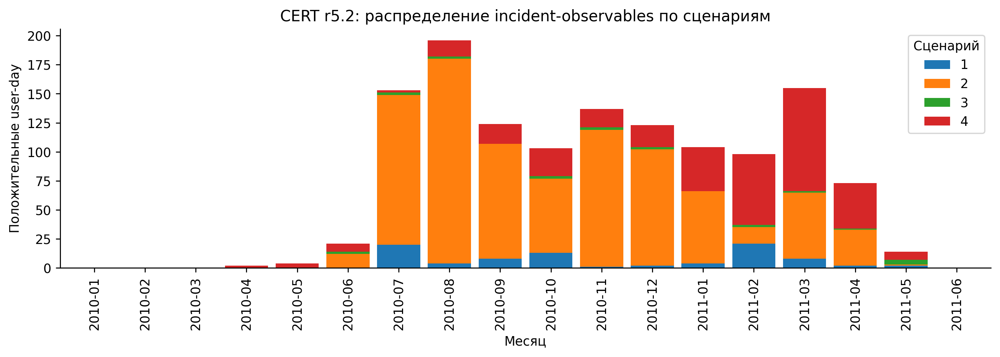
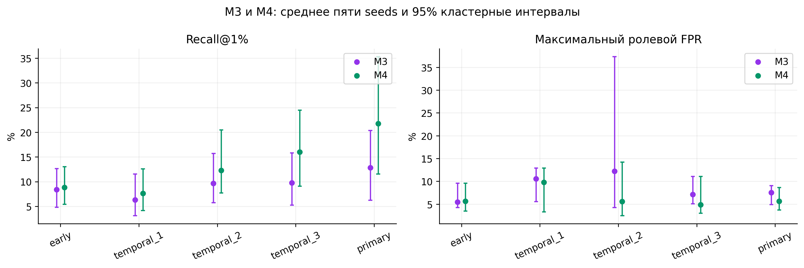
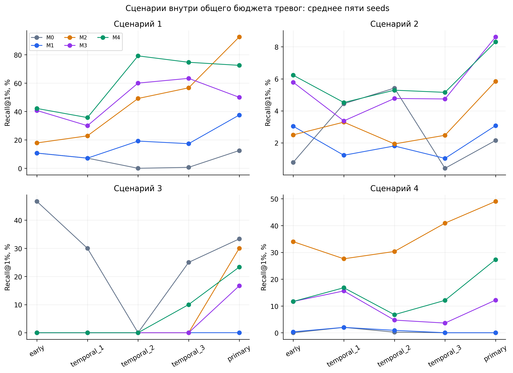
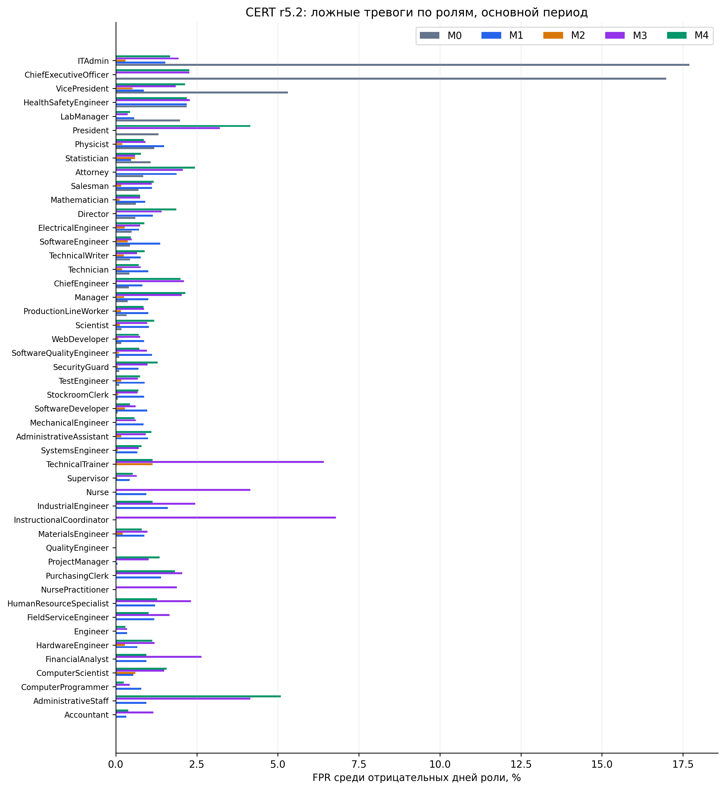

# CERT r5.2: проверка переноса фиксированной контекстной калибровки

Дата: 2026-11-02. Это новое исследование фиксированных M0–M4 на другом выпуске CERT. Обучение детектора и калибровка выполняются заново на r5.2; результат не является переносом одного обученного детектора на другую реальную организацию.

## Основной вывод

Преимущество M4 над M3 по Recall@1% в основном периоде не подтверждено. Статистически подтверждённого снижения максимального ролевого FPR относительно M3 нет.

Контекстный выигрыш на сценарии 4 подтверждён для: primary:M2-M0, temporal_2:M2-M0, temporal_3:M2-M0. Это перенос конкретных методов и периодов; он не подтверждает превосходство M4 или всех контекстных схем.

Устойчивый положительный перенос M3/M4 относительно M0 на новый сценарий 4 статистически не подтверждён.

В численных таблицах метрики даны долями от 0 до 1; разности также в долях. Умножение на 100 переводит их в проценты и процентные пункты. На графиках использованы проценты.

## 1. Источники и официальная разметка

Официальный [CERT Insider Threat Test Dataset](https://www.sei.cmu.edu/library/insider-threat-test-dataset/) ([DOI](https://doi.org/10.1184/R1/12841247.v1)). Архив r5.2: 11 137 370 937 байт; MD5/SHA256 сверены с опубликованными метаданными. Согласованы 99 incident-файлов с insiders.csv. После удаления двух повторных ссылок: 10326 событий, 1307 положительных account-day у 99 аккаунтов.

Две ссылки сценария 4 относятся к другим аккаунтам и присутствуют также в их собственных ключах. Они учтены один раз по (тип журнала,id), со всеми исходными ссылками. Правило подмены аккаунта из r4.2 не применялось автоматически. Ключи r5.2 не перечисляют в точности тот же набор контекстных событий, что r4.2: метка означает официальный incident-observable, включая подготовку, а не доказанный злой умысел каждого действия. Все дни insider положительными не объявляются.

| scenario | incidents | positive_days |
| --- | --- | --- |
| 1 | 29 | 85 |
| 2 | 30 | 863 |
| 3 | 10 | 20 |
| 4 | 30 | 339 |
| 5 | 0 | 0 |

Сценарий 4 — доступ к чужим файлам и отправка на личную почту — новый относительно r4.2. Сценарий 5 отсутствует в r5.2; вывод о нём по этому выпуску невозможен.

## 2. Сопоставимые признаки из исходных журналов

Агрегировано 692645 активных user-day, 2000 пользователей, 48 ролей. Положительных дней в восстановленной выборке: 1307; не представленных выбранными журналами дней ключа: 0. Дней UNKNOWN: 0.

Готовые сторонние признаки не использовались. Сохранены 17 имён признаков r4.2. В email учитываются только Send, а не Receive. В file — File Write/Copy с to_removable_media=True. File Open/локальные чтения не считаются прежними USB-копиями. README r5.2 содержит устаревшее описание file.csv; адаптер проверен по реальному заголовку и комбинациям полей. Запись и копирование на USB имеют не полностью тождественную гранулярность: это остаточное ограничение сопоставления, а не замена всех новых файловых событий старым счётчиком. Суммы событий и уникальные PC вычислены по выбранным сопоставимым событиям. Роль — последний не будущий LDAP-снимок; window 08:00–18:00 фиксирован; оценка в конце дня. HTTP-признаки исключены, как в r4.2, но HTTP ключей учитывается в метках.

Сопоставление: data/processed/r5.2/feature_comparability.csv. Покрытие official observables выбранными событиями: key_event_coverage.csv и label_day_feature_coverage.csv. Наличие обычных logon/email в положительном дне не означает, что их численные счётчики отражают содержание конкретной атаки.

## 3. Замороженные модели и временные периоды

Формулы M0–M4 побайтно сверены с сохранённым r4.2 review ZIP. M4: k_user=30, k_role=200; M3: равное среднее user/role. Fallback M1: n_role<30, M2: n_user<5. IsolationForest 200 деревьев, max_samples=min(2048,n_train), seeds 42–46. Нормировщик и импутация обучаются только на train. Один общий детектор на seed/период; никакого выбора модели или сетки k по изученному r4.2 и новому r5.2. Калибровочные профили заморожены до validation/test. Доказанные conformal-гарантии смеси не утверждаются.

Все пять хронологических протоколов зафиксированы заранее. Основной — 50/20/15/15%; дополнительные — early 20/10/10/20%, temporal_1 30/15/10/15%, temporal_2 40/15/10/15%, temporal_3 50/15/10/15%. Остаток после test исключается. Перекрывающиеся тесты не объединяются и не считаются независимыми повторениями.

| period | block | start | stop_exclusive | days | positives | positive_users |
| --- | --- | --- | --- | --- | --- | --- |
| primary | train | 2010-01-02 | 2010-09-17 | 361094 | 460 | 34 |
| primary | calibration | 2010-09-17 | 2010-12-29 | 132527 | 394 | 38 |
| primary | validation | 2010-12-29 | 2011-03-17 | 102258 | 292 | 42 |
| primary | test | 2011-03-17 | 2011-06-03 | 96766 | 161 | 25 |
| early | train | 2010-01-02 | 2010-04-15 | 146603 | 0 | 0 |
| early | calibration | 2010-04-15 | 2010-06-06 | 72435 | 8 | 1 |
| early | validation | 2010-06-06 | 2010-07-27 | 69667 | 133 | 21 |
| early | test | 2010-07-27 | 2010-11-08 | 141852 | 502 | 41 |
| temporal_1 | train | 2010-01-02 | 2010-06-06 | 219038 | 8 | 1 |
| temporal_1 | calibration | 2010-06-06 | 2010-08-22 | 106918 | 312 | 29 |
| temporal_1 | validation | 2010-08-22 | 2010-10-13 | 69999 | 203 | 21 |
| temporal_1 | test | 2010-10-13 | 2010-12-29 | 97666 | 331 | 31 |
| temporal_2 | train | 2010-01-02 | 2010-07-27 | 288705 | 141 | 21 |
| temporal_2 | calibration | 2010-07-27 | 2010-10-13 | 107250 | 382 | 27 |
| temporal_2 | validation | 2010-10-13 | 2010-12-04 | 68965 | 242 | 26 |
| temporal_2 | test | 2010-12-04 | 2011-02-19 | 97674 | 270 | 41 |
| temporal_3 | train | 2010-01-02 | 2010-09-17 | 361094 | 460 | 34 |
| temporal_3 | calibration | 2010-09-17 | 2010-12-04 | 103826 | 305 | 33 |
| temporal_3 | validation | 2010-12-04 | 2011-01-24 | 60709 | 182 | 26 |
| temporal_3 | test | 2011-01-24 | 2011-04-12 | 103318 | 308 | 41 |

Поддержка сценариев во всех тестовых периодах (до обучения):

| period | scenario | positive_days | positive_accounts | incidents | supported |
| --- | --- | --- | --- | --- | --- |
| primary | 1 | 8 | 3 | 3 | False |
| primary | 2 | 65 | 3 | 3 | False |
| primary | 3 | 6 | 3 | 3 | False |
| primary | 4 | 82 | 16 | 16 | True |
| primary | 5 | 0 | 0 | 0 | False |
| early | 1 | 28 | 10 | 10 | True |
| early | 2 | 408 | 21 | 21 | True |
| early | 3 | 6 | 3 | 3 | False |
| early | 4 | 60 | 7 | 7 | True |
| early | 5 | 0 | 0 | 0 | False |
| temporal_1 | 1 | 14 | 5 | 5 | False |
| temporal_1 | 2 | 261 | 13 | 13 | True |
| temporal_1 | 3 | 6 | 3 | 3 | False |
| temporal_1 | 4 | 50 | 10 | 10 | True |
| temporal_1 | 5 | 0 | 0 | 0 | False |
| temporal_2 | 1 | 24 | 9 | 9 | True |
| temporal_2 | 2 | 155 | 12 | 12 | True |
| temporal_2 | 3 | 2 | 1 | 1 | False |
| temporal_2 | 4 | 89 | 19 | 19 | True |
| temporal_2 | 5 | 0 | 0 | 0 | False |
| temporal_3 | 1 | 30 | 10 | 10 | True |
| temporal_3 | 2 | 97 | 6 | 6 | True |
| temporal_3 | 3 | 4 | 2 | 2 | False |
| temporal_3 | 4 | 177 | 23 | 23 | True |
| temporal_3 | 5 | 0 | 0 | 0 | False |

Недостаточная поддержка (<20 положительных дней или <5 аккаунтов) ограничивает выводы даже при узком bootstrap-интервале: несколько дней одного сценария не заменяют независимых атак.

## 4. Основной тест: M0–M4

| method | recall_at_1pct | precision_at_1pct | max_role_fpr | max_role_fpr_n100 | fpr | recall | precision | pr_auc | roc_auc | alert_rate |
| --- | --- | --- | --- | --- | --- | --- | --- | --- | --- | --- |
| M0 | 0.0273 | 0.0045 | 0.1852 | 0.1770 | 0.0102 | 0.0273 | 0.0044 | 0.0059 | 0.8648 | 0.0102 |
| M1 | 0.0311 | 0.0052 | 0.0228 | 0.0228 | 0.0098 | 0.0311 | 0.0052 | 0.0078 | 0.8766 | 0.0099 |
| M2 | 0.3304 | 0.0550 | 0.0140 | 0.0068 | 0.0017 | 0.0261 | 0.0246 | 0.0290 | 0.8267 | 0.0018 |
| M3 | 0.1280 | 0.0213 | 0.0755 | 0.0472 | 0.0101 | 0.1304 | 0.0211 | 0.0173 | 0.8852 | 0.0103 |
| M4 | 0.2174 | 0.0362 | 0.0566 | 0.0566 | 0.0100 | 0.2236 | 0.0360 | 0.0220 | 0.8646 | 0.0103 |

Recall@1% использует ceil(1%*n_test) наблюдений в общем рейтинге, связки разрешаются прежним SHA256(user,date). Max-role FPR относится к отдельному проспективному порогу 99%-квантиля validation, с тревогой score>threshold. Эти два протокола не смешиваются. Полная таблица также содержит бюджеты 0.5%/2% и отдельный validation-FPR-порог в metrics.csv.

Фактическая доля тревог при проспективном пороге в основном периоде:

| method | validation_alert_rate | alert_rate |
| --- | --- | --- |
| M0 | 0.0100 | 0.0102 |
| M1 | 0.0100 | 0.0099 |
| M2 | 0.0017 | 0.0018 |
| M3 | 0.0100 | 0.0103 |
| M4 | 0.0100 | 0.0103 |

Из-за дискретных персональных p-values M2 может не достигать validation-цели 1% при заранее выбранном строгом пороге. Его низкий проспективный FPR следует читать вместе с фактической долей тревог и проспективным recall. Ретроспективный top-1% остаётся отдельным сравнением при одинаковом числе тревог; порог после теста не менялся.

Основная семья: два сравнения M4−M3; 95% интервалы и Holm:

| comparison | metric | difference | lower | upper | p_holm_primary |
| --- | --- | --- | --- | --- | --- |
| M4-M3 | recall_at_1pct | 0.0894 | 0.0211 | 0.2034 | 0.1096 |
| M4-M3 | max_role_fpr | -0.0189 | -0.0345 | 0.0137 | 0.2004 |

## 5. Перенос по времени и сравнение с r4.2

| period | method | recall_at_1pct | max_role_fpr | max_role_fpr_n100 | fpr |
| --- | --- | --- | --- | --- | --- |
| early | M0 | 0.0179 | 0.1688 | 0.1597 | 0.0096 |
| early | M1 | 0.0311 | 0.0255 | 0.0255 | 0.0106 |
| early | M2 | 0.0709 | 0.0145 | 0.0145 | 0.0041 |
| early | M3 | 0.0837 | 0.0548 | 0.0479 | 0.0113 |
| early | M4 | 0.0880 | 0.0562 | 0.0562 | 0.0111 |
| primary | M0 | 0.0273 | 0.1852 | 0.1770 | 0.0102 |
| primary | M1 | 0.0311 | 0.0228 | 0.0228 | 0.0098 |
| primary | M2 | 0.3304 | 0.0140 | 0.0068 | 0.0017 |
| primary | M3 | 0.1280 | 0.0755 | 0.0472 | 0.0101 |
| primary | M4 | 0.2174 | 0.0566 | 0.0566 | 0.0100 |
| temporal_1 | M0 | 0.0465 | 0.1936 | 0.1733 | 0.0111 |
| temporal_1 | M1 | 0.0157 | 0.0284 | 0.0284 | 0.0121 |
| temporal_1 | M2 | 0.0773 | 0.0296 | 0.0087 | 0.0031 |
| temporal_1 | M3 | 0.0628 | 0.1059 | 0.0425 | 0.0123 |
| temporal_1 | M4 | 0.0761 | 0.0980 | 0.0363 | 0.0122 |
| temporal_2 | M0 | 0.0319 | 0.1679 | 0.1558 | 0.0091 |
| temporal_2 | M1 | 0.0304 | 0.0234 | 0.0234 | 0.0083 |
| temporal_2 | M2 | 0.1548 | 0.0333 | 0.0050 | 0.0020 |
| temporal_2 | M3 | 0.0963 | 0.1224 | 0.0481 | 0.0085 |
| temporal_2 | M4 | 0.1230 | 0.0560 | 0.0356 | 0.0083 |
| temporal_3 | M0 | 0.0052 | 0.1907 | 0.1700 | 0.0100 |
| temporal_3 | M1 | 0.0201 | 0.0252 | 0.0252 | 0.0099 |
| temporal_3 | M2 | 0.2981 | 0.0082 | 0.0060 | 0.0020 |
| temporal_3 | M3 | 0.0974 | 0.0714 | 0.0456 | 0.0101 |
| temporal_3 | M4 | 0.1597 | 0.0487 | 0.0380 | 0.0099 |

Сопоставление основных периодов двух выпусков — описательное, поскольку различаются фон, число пользователей, временные границы и доли сценариев:

| release | method | recall_at_1pct | max_role_fpr | recall | fpr |
| --- | --- | --- | --- | --- | --- |
| r4.2 | M0 | 0.0215 | 0.2008 | 0.0185 | 0.0096 |
| r4.2 | M1 | 0.1723 | 0.0256 | 0.1600 | 0.0092 |
| r4.2 | M2 | 0.1969 | 0.0113 | 0.0000 | 0.0013 |
| r4.2 | M3 | 0.3508 | 0.0722 | 0.3292 | 0.0081 |
| r4.2 | M4 | 0.3631 | 0.0722 | 0.3446 | 0.0079 |
| r5.2 | M0 | 0.0273 | 0.1852 | 0.0273 | 0.0102 |
| r5.2 | M1 | 0.0311 | 0.0228 | 0.0311 | 0.0098 |
| r5.2 | M2 | 0.3304 | 0.0140 | 0.0261 | 0.0017 |
| r5.2 | M3 | 0.1280 | 0.0755 | 0.1304 | 0.0101 |
| r5.2 | M4 | 0.2174 | 0.0566 | 0.2236 | 0.0100 |

## 6. Сохраняется ли выигрыш на новом сценарии 4?

Контекстный выигрыш на сценарии 4 подтверждён для: primary:M2-M0, temporal_2:M2-M0, temporal_3:M2-M0. Это перенос конкретных методов и периодов; он не подтверждает превосходство M4 или всех контекстных схем.

Устойчивый положительный перенос M3/M4 относительно M0 на новый сценарий 4 статистически не подтверждён.

Отдельный top-K по сценарию не строится. Числитель — дни сценария внутри глобального top-1%; знаменатель — все положительные дни этого сценария в данном тесте.

| period | comparison | positive_days | positive_accounts | supported | difference | lower | upper | p_holm_scenario |
| --- | --- | --- | --- | --- | --- | --- | --- | --- |
| primary | M1-M0 | 82 | 16 | True | 0.0000 | 0.0000 | 0.0000 | 1.0000 |
| primary | M2-M0 | 82 | 16 | True | 0.4902 | 0.3042 | 0.6736 | 0.0200 |
| primary | M3-M0 | 82 | 16 | True | 0.1220 | 0.0299 | 0.2218 | 1.0000 |
| primary | M4-M0 | 82 | 16 | True | 0.2732 | 0.0999 | 0.4227 | 0.1611 |
| primary | M4-M3 | 82 | 16 | True | 0.1512 | 0.0308 | 0.3091 | 1.0000 |
| early | M1-M0 | 60 | 7 | True | 0.0033 | 0.0000 | 0.0100 | 1.0000 |
| early | M2-M0 | 60 | 7 | True | 0.3400 | 0.2170 | 0.4400 | 1.0000 |
| early | M3-M0 | 60 | 7 | True | 0.1167 | 0.0000 | 0.3415 | 1.0000 |
| early | M4-M0 | 60 | 7 | True | 0.1167 | 0.0000 | 0.3415 | 1.0000 |
| early | M4-M3 | 60 | 7 | True | 0.0000 | 0.0000 | 0.0000 | 1.0000 |
| temporal_1 | M1-M0 | 50 | 10 | True | 0.0000 | 0.0000 | 0.0279 | 1.0000 |
| temporal_1 | M2-M0 | 50 | 10 | True | 0.2560 | 0.0476 | 0.5000 | 1.0000 |
| temporal_1 | M3-M0 | 50 | 10 | True | 0.1360 | 0.0000 | 0.4000 | 1.0000 |
| temporal_1 | M4-M0 | 50 | 10 | True | 0.1480 | 0.0039 | 0.4111 | 1.0000 |
| temporal_1 | M4-M3 | 50 | 10 | True | 0.0120 | 0.0000 | 0.0353 | 1.0000 |
| temporal_2 | M1-M0 | 89 | 19 | True | 0.0067 | 0.0000 | 0.0211 | 1.0000 |
| temporal_2 | M2-M0 | 89 | 19 | True | 0.3011 | 0.1705 | 0.4492 | 0.0200 |
| temporal_2 | M3-M0 | 89 | 19 | True | 0.0449 | 0.0099 | 0.0886 | 1.0000 |
| temporal_2 | M4-M0 | 89 | 19 | True | 0.0652 | 0.0269 | 0.1492 | 1.0000 |
| temporal_2 | M4-M3 | 89 | 19 | True | 0.0202 | 0.0026 | 0.0951 | 1.0000 |
| temporal_3 | M1-M0 | 177 | 23 | True | 0.0000 | 0.0000 | 0.0018 | 1.0000 |
| temporal_3 | M2-M0 | 177 | 23 | True | 0.4090 | 0.2748 | 0.5342 | 0.0200 |
| temporal_3 | M3-M0 | 177 | 23 | True | 0.0362 | 0.0113 | 0.0701 | 1.0000 |
| temporal_3 | M4-M0 | 177 | 23 | True | 0.1209 | 0.0386 | 0.2049 | 0.8892 |
| temporal_3 | M4-M3 | 177 | 23 | True | 0.0847 | 0.0089 | 0.1656 | 1.0000 |

Полные результаты для сценариев 1–5, включая неопределённые значения отсутствующего сценария 5, сохранены в tables/scenario_confidence_intervals.csv и all_scenario_comparisons.csv. Прирост агрегата не доказывает прирост на каждом сценарии; основной период и дополнительные окна интерпретируются отдельно.

## 7. Статистика и пределы выводов

9999 парных bootstrap-выборок по аккаунтам, среднее пяти seeds внутри каждой выборки; одни и те же выбранные пользователи у методов. CI условны на обученных моделях, calibration и порогах; переобучение в bootstrap не производится. Основная Holm-семья содержит два теста M4−M3 основного периода. Дополнительная семья включает все пять пар по двум основным endpoints всех пяти периодов; отдельная сценарная семья — все пары/сценарии/периоды по Recall@1% и проспективному recall. Числа фактически определённых тестов приведены в multiplicity_families.json. Пустые положительные bootstrap-выборки дают неопределённый recall, а не ноль; их число сохранено. Nominal p-values — приближённый centered bootstrap, не точный рандомизационный тест.

Перцентильные 95% CI и центрированный bootstrap-тест не являются инверсией друг друга при асимметричных дискретных распределениях. Поэтому CI может не включать ноль при несущественном p этого теста, особенно после Holm. Решение о значимости принято по заранее заданному скорректированному p; положительный CI не используется для замены этого критерия. В частности, у M4−M3 основной Recall@1% имеет положительный перцентильный CI, но p после Holm превышает 0.05.

Максимум role-FPR чувствителен к редким ролям; дополнительно показан максимум при n_negative>=100. Синтетический характер обоих выпусков и общий генератор ограничивают внешнюю валидность для реальных компаний. Исключённые HTTP/содержание писем/названия файлов могут быть принципиальны для новых низкообъёмных атак. Ложные тревоги и риск подготовительной активности не следует отождествлять с доказанными инцидентами.

## 8. Рисунки

## Воспроизведение

Предварительный протокол: [docs/protocol_r5_2.md](../docs/protocol_r5_2.md). Команды: [README_R5_2.md](../README_R5_2.md). Контроль неизменности методов — results/r5_2/locked_methods.json, зафиксированный план — preflight_plan.json. Все первичные предсказания и scores сохранены по seed/периоду. Старые результаты r4.2 сохранены.
