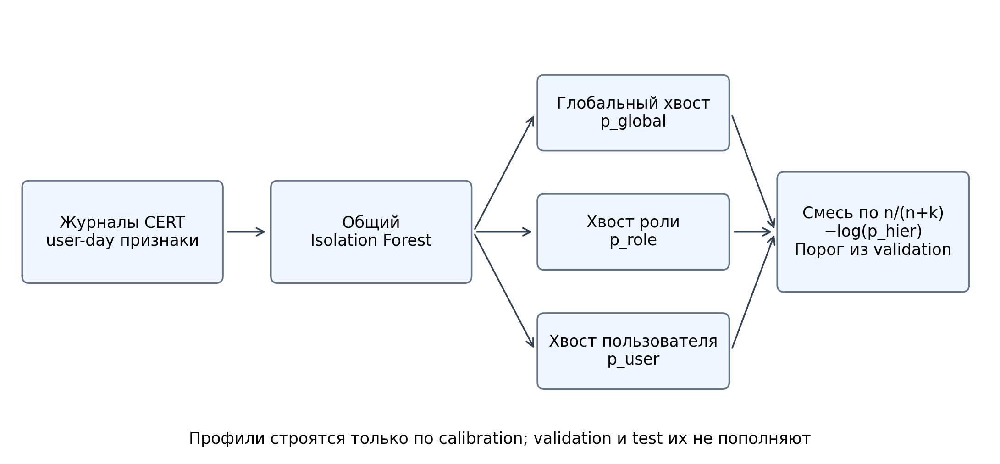
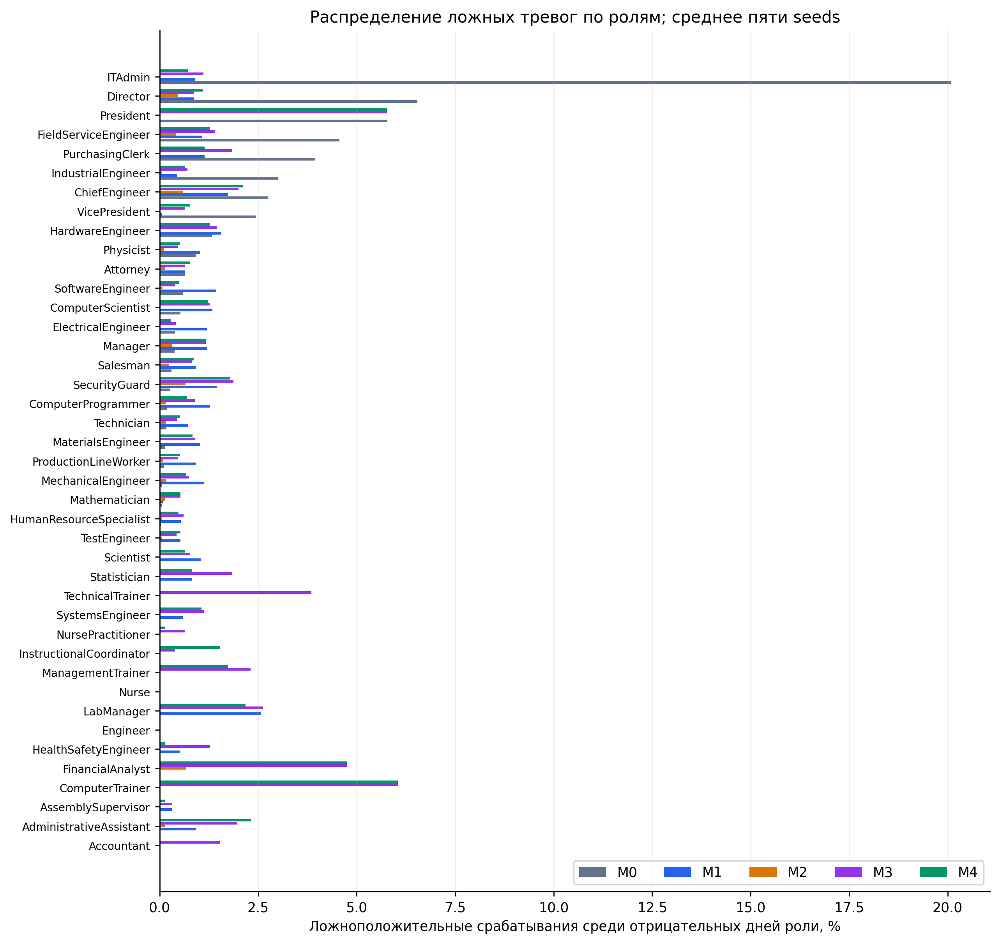
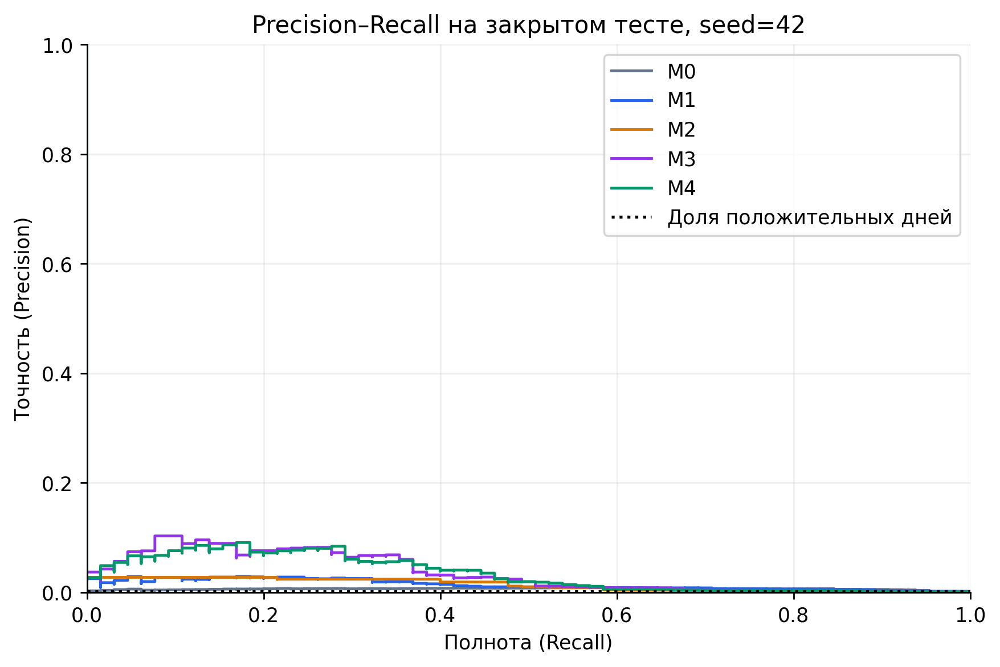
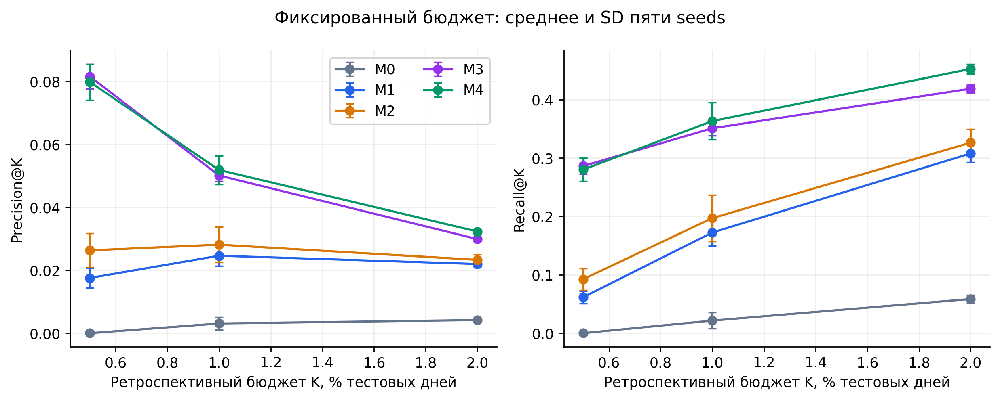
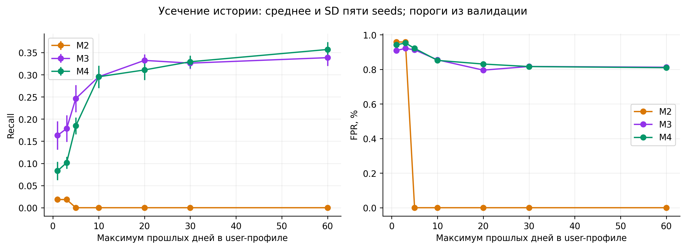

# Иерархическая контекстная калибровка аномальности: экспериментальный отчёт

Дата исследования: 2026-11-02. Источник задания: task.md.

Основной результат — протокол `primary`; дополнительные временные окна, если они есть, не заменяют его. Все приведённые числа вычислены сохранённым кодом на исходных журналах CERT.

## 1. Исходные данные и экспериментальная выборка

| Показатель | Значение |
| --- | --- |
| Пользователи | 1000 |
| Активные user-day | 330452 |
| Положительные дни | 976 |
| Отрицательные дни | 329476 |
| Учётные записи с положительными днями | 72 |
| Роли | 42 |
| Дни без роли | 0 |
| Пропущенные дни меток | 0 |
| Период | 2010-01-02 — 2011-05-17 |
| Признаки | 17 |
| HTTP-признаки | нет |

CERT r4.2 — синтетический набор. Загружен официальный архив CMU/Figshare; MD5 и SHA256 проверены. Источники и хеши находятся в `data/raw/*.provenance.json`, хеши извлечённых журналов — в `data/metadata/extracted_manifest.json`.

Целевая метка соответствует дню с incident-observable, подтверждённым официальным answer key. Интервалы риска не растягиваются на все дни сотрудника. Аудит выделил 7303 событий и 976 account-day в ключах; 20 обычных ответов руководителей исключены, 30 событий под украденными учётными записями включены. Подготовительные действия в ключе не являются доказательством злого умысла каждого события. Отрицательная метка означает отсутствие события в ключе.

Zenodo 19435851 проверен отдельно: матрицы не содержат меток. Все пять проверенных *_z_user столбцов в точности воспроизводятся нормировкой по полной истории пользователя (ddof=1; максимальная ошибка 0.0 для каждого столбца). Это делает их непригодными готовыми признаками для причинного временного эксперимента. Матрицы не использовались для численных результатов отчёта; проверка сохранена в data/metadata/zenodo_audit.json.

## 2. Признаки и обработка

`afterhours_events`, `device_afterhours`, `device_events`, `email_afterhours`, `email_events`, `external_recipients`, `file_afterhours`, `file_events`, `logoffs`, `logon_afterhours`, `logon_events`, `logons`, `total_events`, `unique_pcs`, `usb_connects`, `usb_disconnects`, `weekend_events`.

Оценка формируется в конце дня. Действия вне 08:00–18:00 по локальному времени журналов считаются after-hours; это фиксированное определение, а не индивидуальная оценка рабочего расписания. Сессии не восстанавливались. Для внешних адресатов использован домен организации dtaa.com, адресаты дедуплицируются внутри письма. Роль присоединяется из последнего не будущего месячного LDAP-снимка; ID, роль, дата и метка не входят в признаки детектора. HTTP исключён: часть положительных дней может содержать только HTTP-свидетельства, что ограничивает наблюдаемость атак. По README r4.2 file.csv содержит именно копирование файлов на съёмные носители, а идентификаторы уникальны внутри журнала: метки сопоставлены по (event_type,id).

## 3. Базовый детектор и методы

Для каждого seed обучен один общий IsolationForest (200 деревьев, max_samples=min(2048,n_train), n_jobs=-1); scores общие для всех методов. Импутация медианой и StandardScaler обучаются только на train. Использован `-score_samples`: большее значение означает большую аномальность. Train не очищается от атак по целевой метке; загрязнение отражено в split_support. Seeds: 42, 43, 44, 45, 46.

M0 использует исходный score; M1 — ролевую хвостовую вероятность с global-fallback при n_role<30; M2 — персональную с global-fallback при n_user<5. M3 — равновесное среднее p_user и p_role, отсутствующий профиль заменяется global. Все калибровочные профили заморожены после calibration и не пополняются validation/test.

## 4. Математическое описание M4

Для каждого уровня `p(s)=(1+#{s_i>=s})/(n+1)`. Связки учитываются через `>=`.

`w_user=n_user/(n_user+30)`, `w_role=n_role/(n_role+200)`.

`p_hier=w_user*p_user+(1-w_user)*(w_role*p_role+(1-w_role)*p_global)`.

`score_hier=-log(p_hier)`. При отсутствии профиля его вес равен нулю. Для этой смеси не доказаны строгие conformal-гарантии; хронологический дрейф и зависимость user-day также ограничивают применимость предположения exchangeability.

## 5. Протоколы и статистические ограничения

Основное разбиение: 50/20/15/15% глобального календарного диапазона. Проспективный порог фиксируется по 99%-квантилю validation; тревога score>threshold. При связках доля тревог может быть меньше 1%. Отдельно рассчитывается порог FPR<=1% по отрицательным validation-дням; фактическое соблюдение ограничения на тесте не предполагается автоматически. Top-K — ретроспективная оценка ранжирования.

95% CI: 1000 парных bootstrap-выборок кластеров пользователей; внутри каждой выборки метрики усредняются по пяти seeds. Дни одного пользователя не считаются независимыми. Интервалы условны на обученных моделях, выбранных порогах и calibration; не включают повторную выборку обучающих историй. Поправка Holm применяется к шести основным двусторонним сравнениям M4−M0/M3 по max-role FPR, recall, Recall@1%. Остальные p-values являются описательными, не подтверждающими выводами.

## 6. Результаты протокола primary

Доли календарного диапазона: [0.5, 0.2, 0.15, 0.15]. Конец каждого блока исключается.

| block | start | stop_exclusive | days | positives | positive_users |
| --- | --- | --- | --- | --- | --- |
| train | 2010-01-02 | 2010-09-09 | 173946 | 375 | 29 |
| calibration | 2010-09-09 | 2010-12-18 | 65908 | 334 | 37 |
| validation | 2010-12-18 | 2011-03-03 | 45138 | 202 | 19 |
| test | 2011-03-03 | 2011-05-18 | 45460 | 65 | 9 |

Число положительных дней и пользователей проверено до обучения. Оптимистическая оценка половины 95%-интервала recall при независимых днях (p=0.5) сохранена в split_support; это не формальный power-анализ кластерного парного сравнения. Ограничение допускаемой потери recall в 2 п.п. может быть существенно тоньше доступного статистического разрешения.

### Эксперимент 1: наблюдаемые ограничения M0–M2

| method | fpr | recall | max_role_fpr | role_fpr_std | pr_auc |
| --- | --- | --- | --- | --- | --- |
| M0 | 0.0096 | 0.0185 | 0.2008 | 0.0343 | 0.0063 |
| M1 | 0.0092 | 0.1600 | 0.0256 | 0.0063 | 0.0130 |
| M2 | 0.0013 | 0.0000 | 0.0113 | 0.0023 | 0.0150 |

Сводка показывает различия частот по ролям; это наблюдаемая ассоциация, а не доказательство причинности роли. Полные знаменатели и кластерные CI находятся в role_metrics.csv и role_confidence_intervals.csv.

Достижимость validation-бюджета при связанных оценках:

| method | alert_rate_strict | alert_rate_inclusive | mass_at_threshold |
| --- | --- | --- | --- |
| M0 | 0.0100 | 0.0100 | 0.0000 |
| M1 | 0.0100 | 0.0100 | 0.0000 |
| M2 | 0.0017 | 0.0129 | 0.0112 |
| M3 | 0.0100 | 0.0100 | 0.0000 |
| M4 | 0.0100 | 0.0100 | 0.0000 |

Для M2 переход от строгого `>` к `>=` включает целый блок одинаковых оценок и может перескочить целевой бюджет. Это измеримый эффект дискретной персональной ECDF; заранее выбранный строгий порог после теста не изменялся. Низкий recall M2 при пороге не означает нулевой способности ранжировать.

У M0 максимальный средний ролевой FPR наблюдается в роли **ITAdmin**: 20.079% при общем FPR 0.962%. Сравнение с малочисленными ролями требует учитывать знаменатели; дополнительно сохранён max-role FPR для n_negative>=100.

Естественная длина персональной calibration-истории:

| history | days | positive | negative |
| --- | --- | --- | --- |
| 0 | 0.0000 | 0.0000 | 0.0000 |
| 1-4 | 0.0000 | 0.0000 | 0.0000 |
| 15-29 | 0.0000 | 0.0000 | 0.0000 |
| 30+ | 45460.0000 | 65.0000 | 45395.0000 |
| 5-14 | 0.0000 | 0.0000 | 0.0000 |

Если короткие истории почти отсутствуют, их нестабильность нельзя доказывать только этим разбиением. Поэтому отдельно выполнен заранее заданный стресс-тест усечения до 1/3/5/10/20/30/60 прошлых дней. У M2 предусмотрен global-fallback при n_user<5: его поведение на 1–3 днях не является поведением чистой персональной ECDF.

### Эксперимент 2: сравнение M0–M4

| method | fpr | recall | precision | f1 | pr_auc | roc_auc | max_role_fpr |
| --- | --- | --- | --- | --- | --- | --- | --- |
| M0 | 0.0096 | 0.0185 | 0.0027 | 0.0048 | 0.0063 | 0.8549 | 0.2008 |
| M1 | 0.0092 | 0.1600 | 0.0242 | 0.0421 | 0.0130 | 0.8672 | 0.0256 |
| M2 | 0.0013 | 0.0000 | 0.0000 | 0.0000 | 0.0150 | 0.7558 | 0.0113 |
| M3 | 0.0081 | 0.3292 | 0.0553 | 0.0947 | 0.0342 | 0.8309 | 0.0722 |
| M4 | 0.0079 | 0.3446 | 0.0587 | 0.1003 | 0.0345 | 0.8034 | 0.0722 |

Ложные тревоги на 1000 дней, фактическая доля тревог и результаты всех трёх бюджетов сохранены в tables/table_3_main_metrics.csv.

| method | precision_at_0.5pct | recall_at_0.5pct | precision_at_1pct | recall_at_1pct | precision_at_2pct | recall_at_2pct |
| --- | --- | --- | --- | --- | --- | --- |
| M0 | 0.0000 | 0.0000 | 0.0031 | 0.0215 | 0.0042 | 0.0585 |
| M1 | 0.0175 | 0.0615 | 0.0246 | 0.1723 | 0.0220 | 0.3077 |
| M2 | 0.0263 | 0.0923 | 0.0281 | 0.1969 | 0.0233 | 0.3262 |
| M3 | 0.0816 | 0.2862 | 0.0501 | 0.3508 | 0.0299 | 0.4185 |
| M4 | 0.0798 | 0.2800 | 0.0519 | 0.3631 | 0.0323 | 0.4523 |

95% кластерные интервалы основных метрик:

| method | metric | estimate | lower | upper |
| --- | --- | --- | --- | --- |
| M0 | fpr | 0.0096 | 0.0054 | 0.0142 |
| M0 | recall | 0.0185 | 0.0000 | 0.0834 |
| M0 | max_role_fpr | 0.2008 | 0.0961 | 0.3246 |
| M0 | recall_at_1pct | 0.0215 | 0.0000 | 0.0968 |
| M1 | fpr | 0.0092 | 0.0066 | 0.0119 |
| M1 | recall | 0.1600 | 0.0397 | 0.2553 |
| M1 | max_role_fpr | 0.0256 | 0.0239 | 0.0703 |
| M1 | recall_at_1pct | 0.1723 | 0.0300 | 0.2837 |
| M2 | fpr | 0.0013 | 0.0009 | 0.0018 |
| M2 | recall | 0.0000 | 0.0000 | 0.0000 |
| M2 | max_role_fpr | 0.0113 | 0.0065 | 0.0231 |
| M2 | recall_at_1pct | 0.1969 | 0.0871 | 0.3889 |
| M3 | fpr | 0.0081 | 0.0067 | 0.0094 |
| M3 | recall | 0.3292 | 0.0965 | 0.4801 |
| M3 | max_role_fpr | 0.0722 | 0.0450 | 0.1116 |
| M3 | recall_at_1pct | 0.3508 | 0.1090 | 0.5126 |
| M4 | fpr | 0.0079 | 0.0069 | 0.0091 |
| M4 | recall | 0.3446 | 0.1510 | 0.5137 |
| M4 | max_role_fpr | 0.0722 | 0.0357 | 0.1075 |
| M4 | recall_at_1pct | 0.3631 | 0.1666 | 0.5440 |

### Порог, выбранный для FPR<=1% на validation

| method | fpr | recall | precision |
| --- | --- | --- | --- |
| M0 | 0.0096 | 0.0185 | 0.0027 |
| M1 | 0.0093 | 0.1600 | 0.0241 |
| M2 | 0.0013 | 0.0000 | 0.0000 |
| M3 | 0.0085 | 0.3354 | 0.0533 |
| M4 | 0.0085 | 0.3600 | 0.0572 |

Фактическое превышение 1% на тесте проверяется по каждому seed в metrics.csv. Такое превышение означает нарушение переноса целевого FPR, а не повод менять тестовый порог.

### Ablation study и чувствительность

| method | fpr | recall | max_role_fpr | recall_at_1pct |
| --- | --- | --- | --- | --- |
| A_fixed | 0.0082 | 0.3077 | 0.0742 | 0.3385 |
| A_no_role | 0.0083 | 0.3354 | 0.0725 | 0.3446 |
| A_no_user | 0.0094 | 0.0800 | 0.0500 | 0.0831 |
| S_ku10_kr200 | 0.0078 | 0.3446 | 0.0684 | 0.3538 |
| S_ku10_kr50 | 0.0080 | 0.3446 | 0.0684 | 0.3477 |
| S_ku10_kr800 | 0.0079 | 0.3354 | 0.0684 | 0.3692 |
| S_ku30_kr50 | 0.0079 | 0.3508 | 0.0722 | 0.3692 |
| S_ku30_kr800 | 0.0078 | 0.3477 | 0.0656 | 0.3569 |
| S_ku90_kr200 | 0.0082 | 0.3323 | 0.0656 | 0.3415 |
| S_ku90_kr50 | 0.0081 | 0.3323 | 0.0654 | 0.3477 |
| S_ku90_kr800 | 0.0080 | 0.3046 | 0.0709 | 0.3262 |

Основной M4 сохраняет k_user=30, k_role=200 независимо от результатов сетки. Варианты сетки описывают чувствительность; победитель по закрытому тесту не выбирается.

### Парные сравнения и практический критерий

| comparison | metric | difference | lower | upper | p_holm |
| --- | --- | --- | --- | --- | --- |
| M4-M0 | recall | 0.3262 | 0.1000 | 0.5045 | 0.0450 |
| M4-M0 | max_role_fpr | -0.1286 | -0.2593 | -0.0162 | 0.1598 |
| M4-M0 | recall_at_1pct | 0.3415 | 0.1103 | 0.5345 | 0.0420 |
| M4-M3 | recall | 0.0154 | -0.0259 | 0.1000 | 1.0000 |
| M4-M3 | max_role_fpr | 0.0000 | -0.0154 | 0.0000 | 1.0000 |
| M4-M3 | recall_at_1pct | 0.0123 | -0.0233 | 0.1000 | 1.0000 |

Относительное снижение max-role FPR M4 против M0: 64.04%; изменение recall: 32.62 п.п. Точечный совместный критерий снижения FPR/неухудшения recall: выполнен. Сам по себе точечный критерий не доказывает статистическую значимость.

Сценарная неоднородность (среднее пяти seeds):

| method | scenario | positive_days | recall |
| --- | --- | --- | --- |
| M0 | 1 | 1.0000 | 0.0000 |
| M0 | 2 | 61.0000 | 0.0033 |
| M0 | 3 | 3.0000 | 0.3333 |
| M1 | 1 | 1.0000 | 0.0000 |
| M1 | 2 | 61.0000 | 0.1705 |
| M1 | 3 | 3.0000 | 0.0000 |
| M2 | 1 | 1.0000 | 0.0000 |
| M2 | 2 | 61.0000 | 0.0000 |
| M2 | 3 | 3.0000 | 0.0000 |
| M3 | 1 | 1.0000 | 0.0000 |
| M3 | 2 | 61.0000 | 0.3508 |
| M3 | 3 | 3.0000 | 0.0000 |
| M4 | 1 | 1.0000 | 0.0000 |
| M4 | 2 | 61.0000 | 0.3672 |
| M4 | 3 | 3.0000 | 0.0000 |

Естественный тест новых пользователей: 0 аккаунтов, 0 дней, 0 положительных дней. При отсутствии новых аккаунтов этот тест неинформативен.

### Рисунки

### Проверка гипотезы короткой истории

| history_cap | method | recall | fpr |
| --- | --- | --- | --- |
| 1 | M2 | 0.0185 | 0.0096 |
| 1 | M3 | 0.1631 | 0.0091 |
| 1 | M4 | 0.0831 | 0.0094 |
| 3 | M2 | 0.0185 | 0.0096 |
| 3 | M3 | 0.1785 | 0.0092 |
| 3 | M4 | 0.1015 | 0.0095 |
| 60 | M2 | 0.0000 | 0.0000 |
| 60 | M3 | 0.3385 | 0.0081 |
| 60 | M4 | 0.3569 | 0.0081 |

Это отдельный стресс-тест, а не новые пользователи: персональные профили усечены, ролевые и глобальные сохранены. На самых коротких историях M4 может проигрывать равновесному M3, даже превосходя M2 с fallback. Поэтому общий тезис об оптимальности весов по размеру истории из этих результатов не следует.

**Решение для primary: B. Гипотеза подтверждена частично: отдельные показатели улучшаются, но полное утверждение не доказано.**

При одинаковом ретроспективном бюджете 1% Recall@K составляет 2.15% для M0, 35.08% для M3 и 36.31% для M4. Разность M4−M3 равна 1.23 п.п.; 95% CI [-2.33; 10.00] п.п., p после Holm=1.000. Это не доказывает преимущество иерархических весов над простой комбинацией.

## 7. Объяснения и гипотезы

**Факты** приведены в таблицах, seed-предсказаниях и кластерных интервалах. Наличие или отсутствие выигрыша оценивается отдельно для ранжирования и порога.

**Объяснения механизма:** персональная ECDF ограничена разрешением 1/(n_user+1); при редких хвостах многие события получают одинаковый p. Смесь M4 приближает персональные оценки к более крупной ролевой/общей выборке. Но это также может сглаживать полезный индивидуальный сигнал. Загрязнённая calibration-история может повышать персональную норму для повторяющихся атак. Эти свойства следуют из формулы и не доказывают, что именно они вызвали наблюдаемый эффект.

**Гипотезы для дальнейшей проверки:** роль может быть слишком грубой группой; полезность усреднения зависит от различий распределений и объёма истории; HTTP и более точное контекстное описание событий могут изменить результаты. Проверка этих гипотез требует нового заранее заданного эксперимента, а не доработки метода под уже открытый тест.

## 8. Научная новизна

Все четыре заданные публикации подтверждены по первоисточникам; сопоставление механизмов и ограничения доступа описаны в [обзоре литературы](../docs/literature_review.md). У HCC-CP (JSM 2026) уже описана иерархическая калибровка с shrinkage-весами по размеру группы. Поэтому приоритет общей идеи M4 не установлен. Возможный вклад — конкретная UEBA-постановка и воспроизводимое сравнение, но новизна математического механизма недостаточно обоснована. Тождество формул с HCC-CP по одной аннотации проверить нельзя.

## 9. Ограничения

Синтетический CERT, отсутствие внешнего датасета и HTTP-признаков; incident-observable метки включают подготовительную активность; стационарные frozen-профили могут устаревать; роли могут быть неоднородны; bootstrap условен на обучении и калибровке; редкие положительные аккаунты ограничивают мощность; пять seeds не увеличивают число независимых атак. Максимум ролевого FPR чувствителен к малым знаменателям. Наблюдаемые role-FPR не являются сами по себе тестом дискриминации. Полный журнал: [docs/limitations.md](../docs/limitations.md).

## 10. Готовые фрагменты для научной статьи

### Методы

«Оценивание выполнено на исходных журналах CERT r4.2 с единицей наблюдения пользователь–день. Обучение, калибровка, валидация и тест разделены хронологически. Один общий Isolation Forest для каждого из пяти seeds использован во всех сравниваемых схемах калибровки. Параметры основного иерархического метода зафиксированы до анализа тестовых оценок. Неопределённость оценена парным bootstrap с кластеризацией по пользователям».

### Результаты и интерпретация

«B. Гипотеза подтверждена частично: отдельные показатели улучшаются, но полное утверждение не доказано. Результаты ретроспективного ранжирования и проспективного порога следует интерпретировать раздельно. Эксперимент не устанавливает внешнюю валидность для реальных корпоративных журналов и не доказывает строгие conformal-гарантии предложенной смеси». 

## Воспроизведение

Команды и структура артефактов приведены в [README](../README.md). Версии библиотек сохранены в results/environment.json. Численные CSV, прогнозы по seeds и PNG/SVG доступны в results/<protocol>/. Протокол до обучения: [docs/protocol.md](../docs/protocol.md).
